# Dijital Temizlik Takip Projesi - Analiz Özeti (Brief)

> Sahibi: analyst. Durum: **ONAYLANDI** (Faz 0, 2026-11-13, Decisions O-01). K-01..K-15 ve K-38..K-40, K-47 kararları ile Süper admin
> rolü (PL-05) bu belgeye işlendi; diğer K maddelerinin önerilen varsayılanı kabul edildi (`Docs/Analysis/Kusur.md`). Metinde "varsayılanı"
> notu taşıyan kurallar kabul edilmiş varsayılanlardır. Karar kaydı `Docs/Phases/Decisions.md`, yetki matrisi ve ekran envanteri
> `Docs/Analysis/Requirements.md`, faz planı `Docs/Phases/PhasePlan.md`.
> Kaynak: `Docs/Dijital_Temizlik_Takip_Projesi_Is_Birimi_Anlatim_Senaryosu.docx` (düz metin çıkarımı, satır numaraları `doc.txt` satırlarıdır).
> Bu belgede verilen kimlikler (FR, NFR, BR, SC, SH, K) sonraki tüm belgelerde aynen kullanılır; silinen kimlik yeniden kullanılmaz.

---

## 1. Özet

**Problem**

- Makine temizliği kağıt formlarla izleniyor; operatör işi bitirdikten sonra formu doldurabiliyor. Bir adımın o anda mı yoksa sonradan mı
  yazıldığı ayırt edilemiyor (satır 5-6).
- Temizliğin ve aşamalarının ne kadar sürdüğü sistemsel olarak ölçülemiyor; hangi aşamanın uzun sürdüğü görülemiyor (satır 7-8).
- Denetimde "temizlik yapılmıştır" demek yetmiyor; kim, ne zaman, hangi adımı, hangi malzemeyle, ne kadar sürede yaptı gösterilmeli (satır 4, 123-124).

**Hedef**

İşlem gerçekleştiği anda sunucu saatiyle oluşan, önceden tanımlanmış ve versiyonlu prosedüre bağlı, sonradan geriye dönük değiştirilemeyen
ve değiştirilmeye çalışıldığında bunu tespit edilebilir kılan, denetimde kanıt olarak sunulabilen dijital temizlik kaydı (satır 131).

**Başarı ölçütleri**

1. Hiçbir ekranda başlangıç ya da bitiş saati için elle giriş alanı yoktur; tüm zamanlar sunucu saatinden gelir.
2. "Bizim beklediğimiz temel çıktı" listesindeki 13 sorunun tamamı tek kayıt detay ekranından ve denetim çıktısından yanıtlanır (bkz. §4 izlenebilirlik).
3. Aynı makinede iki aktif temizlik, aynı kişinin iki aktif kaydı ve aynı kişinin iki devam eden adımı veritabanı kısıtı nedeniyle oluşamaz (eşzamanlı istekte de).
4. Kayıt bazlı bütünlük doğrulaması, olay günlüğünde yapılan doğrudan bir değişikliği "ihlal" olarak gösterir.
5. Makine ve faz bazında brüt süre, mola, net süre ve efor raporlanır; süre ve efor ayrı gösterilir.
6. Geçmiş bir kayıt, açıldığı andaki prosedür versiyonuyla (faz, adım, minimum süre, medya) görüntülenir.
7. Kritik her işlem, işlemi yapanın PIN'iyle onaylanmıştır; adımdaki her görevlinin katılımı kendi PIN onayını taşır.

---

## 2. Kavram sözlüğü

| Terim | Tanım | Kaynak |
|---|---|---|
| Tesis | Üretimin yapıldığı fiziksel yerleşke; hiyerarşinin en üst düzeyi. | 37 |
| Hat | Bir tesise bağlı üretim hattı. | 37 |
| Makine | Bir hatta bağlı, temizliği yapılan ekipman. Kullanımdan kaldırılabilir, silinmez. | 30, 37 |
| Temizlik tipi / form | Bir makineye uygulanabilecek temizlik checklist dokümanı (ör. ürün değişimi temizliği). Makineyle eşlenir; operatör yalnız eşlenmiş tipleri seçer. | 12-13, 37 |
| Prosedür versiyonu | Temizlik tipinin belirli bir andaki fazları, adımları, minimum süreleri, malzeme zorunluluğu ve medyası. Yayınlandıktan sonra değişmez. | 25-33, 119 |
| Faz | Prosedürün sıralı ana bölümü; her fazın öngörülen minimum süresi vardır. | 14, 17-18 |
| Adım | Fazın içindeki sıralı işlem; açıklama ve isteğe bağlı fotoğraf/video içerir. | 14-16 |
| Malzeme / parti-lot | Temizlikte kullanılan malzeme; kodu, parti/lot bilgisi ve son kullanma tarihi (SKT) vardır. | 20-21 |
| Temizlik kaydı | Bir makinede bir temizlik tipinin bir kez uygulanmasının kaydı. Sahibi, kayıt numarası, durumu ve olay günlüğü vardır. | 34-37 |
| Kayıt sahibi | Kaydı açan kişi; işin sorumlusudur, başkasına devredilemez. | 36 |
| Kayıt numarası | Sistemin açılışta ürettiği, benzersiz, işin yerini okunabilir biçimde içeren numara. | 38-39 |
| Saha defteri referansı | Planlı temizlikte sahadaki kağıt deftere yazılan, sistemin ürettiği referans. | 40 |
| Acil müdahale | Üretim sırasında beklenmeyen durumda yapılan temizlik; "Acil" türündeki kısa bir tiple, açılışla aynı anda başlar; saha referansı yoktur, raporda ayrı görünür. Belgedeki "plansız" ile aynıdır. | 41-44, K-14 |
| Süre | Bir işin başlangıcı ile bitişi arasındaki zaman. Kayıt ve faz için brüt ve net ayrı tutulur. | 61 |
| Net çalışma süresi | Brüt süreden molaların ve beklemede geçen sürenin düşülmesiyle bulunan süre (SH-06, SH-11). Mola verilmemiş boşluk çalışma sayılır. | 67-71, K-02 |
| Brüt süre | İlk adım başlangıcından son adım bitişine geçen duvar saati süresi. | türetilmiş |
| Efor | Harcanan insan emeği: her görevlinin çalıştığı sürelerin toplamı (10 dk x 2 kişi = 20 dk). | 62-64 |
| Yardımcı personel / görevli | Bir adımda sahiple birlikte ya da onun yerine fiilen çalışan kişi; adım bazında seçilir. | 50-53 |
| Olay günlüğü | Kayıt üzerindeki her işlemin (kim, ne zaman, ne) yalnız eklenebilen, değiştirilemeyen listesi. | 129 |
| Müdahale | Yöneticinin kaydı gerekçeyle iptal etmesi, yarıda kapatması ya da beklemeye alması; doğrudan ya da talep onayıyla. | 88-94, K-05 |
| Mola | Operatörün devam eden kayıtta, iki adım arasında ya da adım sürerken açıkça başlatıp bitirdiği ara. Kayıt düzeyindedir: açıkken kayıtta çalışma durur. Süresi kayıt ve faz net süresinden, adımla kesişen kısmı adım süresinden ve eforundan düşülür; açıkken molayı başlatan kişi işlem yapamaz. | 67-71, K-02, K-39 |
| Talep | Kayıt sahibinin yöneticiye açtığı gerekçeli iptal, yarıda kapatma ya da beklemeye alma isteği. | 92-94, K-05, K-08 |
| Beklemede | Yöneticinin kararıyla bekletilen başlamış kayıt; makineyi kilitli tutar, sahibin yeni iş açmasını engellemez. | K-08 |
| Aktif kayıt | "Açıldı" ya da "Devam ediyor" durumundaki kayıt; bir kişinin sahibi olduğu en çok bir aktif kayıt olur. | 76-77, K-08 |
| Kilit süresi, kilit bitişi | Açılan ama başlamayan kaydın makineyi tuttuğu süre; tipten varsayılan gelir, vardiya bitişiyle sınırlanır (SH-13). | 83-87, K-03 |
| Vardiya | Tesis bazında tanımlı çalışma aralığı (ad, başlangıç ve bitiş saati). | 79, K-38 |
| PIN | Kişinin ilk girişte belirlediği kısa rakam kodu; kritik işlemleri onaylar. | K-09 |
| Düzeltme | Değiştirilemez bir bilginin yanlış olduğu anlaşıldığında orijinali koruyarak eklenen gerekçeli düzeltme olayı (öneri). | türetilmiş, K-16 |

---

## 3. Roller ve yetki

### 3.1 Roller

| Rol (sabit) | Kaynak | Açıklama |
|---|---|---|
| Operatör (`Operator`) | 97-99 | Sahada temizlik kaydı ve acil müdahale açar; kendi kaydının ve görevli olduğu adımların işlemlerini yapar; mola verir; kendi kaydı için yöneticiye talep açar; kayıtları görür. Tanımlara dokunmaz. |
| Yönetici (`Manager`) | 100, 94 | Tanımları (tesis, hat, makine, vardiya, temizlik tipi, prosedür versiyonu, malzeme) ve kullanıcıları yönetir; talepleri karara bağlar; kayda doğrudan müdahale eder; tüm kayıtları raporlar; bildirim alır. |
| Denetçi (`Auditor`) (K-48) | türetilmiş (4, 8, 123) | Kayıtları, yönetici panosunu, raporları, denetim çıktısını ve bütünlük doğrulamasını salt okunur görür. |
| Süper admin (`SuperAdmin`) (PL-05) | kullanıcı yanıtı 2026-11-13 | Yönetici ve Süper admin hesaplarını açar, düzenler, pasifleştirir, parola ve PIN sıfırlar; Operatör ve Denetçi hesaplarını da yönetebilir; sistem ayarlarını değiştirir. Saha, tanım, talep, müdahale, rapor ve kayıt ekranlarına erişmez; bunlar gerekiyorsa kişiye ek rol verilir. Seed tek Süper admin içerir. |

Bir kullanıcı birden çok role sahip olabilir (ör. sahada da çalışan yönetici: `Operator` + `Manager`); bkz. K-29.

### 3.2 Yetki matrisi

Rol x ekran x işlem matrisinin yetkili kaynağı `Docs/Analysis/Requirements.md` §3'tür; backend yetkiyi oradan kurar, bu belgede tekrar edilmez.
2026-11-13 kararlarıyla matrise giren değişiklikler: operatör kaydı kendisi iptal etmez, talep açar (K-05); talep, mola, beklemeye alma,
acil müdahale ve bildirim satırları eklendi; kritik işlemler PIN ister (BR-48); Süper admin sütunu ve Sistem ayarları satırı eklendi (PL-05, K-47).

### 3.3 Sahiplik ve kişi kuralları (rolden bağımsız)

> Kaydı görmek, o kaydın adımlarını çalıştırmak anlamına gelmez (satır 102-104).

- **SK-1:** Bir adımı başlatma ve bitirme yalnız (a) kaydın sahibi ya da (b) o adımda görevli olarak belirlenmiş kişi tarafından yapılabilir.
  Yönetici rolü bu hakkı vermez; yöneticinin araçları müdahale ve düzeltmedir.
- **SK-2:** Bir adıma görevli ekleme ve çıkarma yalnız kaydın sahibi tarafından, adım başlamadan yapılır (K-07).
- **SK-3:** Kaydın sahibi hiçbir işlemle değişmez (satır 36).
- **SK-4:** Adıma eklenen kişi katılımını kendi PIN'iyle onaylar; onaylamayan kişi görevli olmaz (K-10).
- **SK-5:** Talebi yalnız kaydın sahibi açar; yalnız talebi açan kişi geri çeker (K-05).
- **SK-6:** Molayı kaydın sahibi ya da kaydın o anki adımının (devam eden adım, yoksa sıradaki adım) görevlisi başlatır; başlatan kişi o anda başka bir kayıtta devam eden adımda olamaz. Yalnız başlatan kişi bitirir, yönetici gerekçeyle bitirebilir (K-39 kararı).
- **SK-7:** Beklemedeki kaydı yalnız sahibi devam ettirir (K-45 varsayılanı).
- **SK-8:** Kritik işlemde girilen PIN oturumdaki kullanıcının PIN'idir. Tek istisna SK-4: eklenen kişi kendi PIN'ini aynı cihazda girer.
- **SK-9:** Hesap yönetimi kapsamı hedef hesabın rollerine bağlıdır. Yönetici yalnız `Manager` ve `SuperAdmin` rolü taşımayan hesapları
  yönetir ve yalnız `Operator` ile `Auditor` rolü atar; Süper admin tüm hesapları yönetir ve tüm rolleri atar. Kimse kendi hesabını
  pasifleştiremez ve kendi rollerini değiştiremez. Son aktif Süper admin pasifleştirilemez ve Süper admin rolü ondan kaldırılamaz (PL-05, PL-16).

**Policy olmadan uygulanışı:** Rol kontrolü action düzeyinde `[Authorize(Roles = Roles.Operator)]` ile yapılır; sahiplik, görevlilik, mola kilidi
ve PIN doğrulaması bir yetki politikası değil, **verinin iş kuralıdır** ve servis katmanında uygulanır:

1. Controller, oturumdaki kullanıcının `UserId` değerini kimlikten okur ve servise parametre olarak geçer (servis HTTP bağlamını bilmez).
2. Servis (ör. `IStepExecutionService.StartStepAsync(recordStepId, actingUserId, pin, commandId, ct)`) aynı transaction içinde PIN'i,
   kişinin açık molası olmadığını ve `record.OwnerUserId == actingUserId` ya da `step.Participants` içinde `actingUserId` olduğunu sorgular.
3. Koşul sağlanmazsa servis işlem yapmadan nedenli bir sonuç döner; controller bunu 403 sayfasına ya da ekranda açıklayıcı mesaja çevirir.
4. Görünüm, aynı servisten gelen `CanStart`, `CanFinish`, `CanManageParticipants`, `CanStartBreak` alanlarına göre düğmeleri gösterir; asıl koruma serviste kalır.
5. SK-9 da aynı biçimde uygulanır: `UsersController` `[Authorize(Roles = Roles.ManagerOrSuperAdmin)]` taşır; servis, işlemi yapanın ve hedef
   hesabın rollerini veritabanından okuyup kapsamı kontrol eder.

`AddPolicy`, `IAuthorizationHandler`, `IAuthorizationRequirement` kullanılmaz. Bu yorum K-30 ile onaylandı (2026-11-13) ve `CodingStandards.md §4`'e yazıldı.

---

## 4. İster listesi

### 4.1 İşlevsel isterler

| Kimlik | İster | Kaynak (doc.txt) | Öncelik |
|---|---|---|---|
| FR-01 | Yönetici tesis, hat ve makine hiyerarşisini tanımlar ve düzenler. | 37, 99-100 | Zorunlu |
| FR-02 | Makine kullanımdan kaldırılabilir; yeni kayıtta seçilemez, geçmiş kayıtları kaybolmaz. | 30-31 | Zorunlu |
| FR-03 | Yönetici temizlik tiplerini (checklist formlarını) tanımlar ve her tipi uygulanabileceği makinelerle eşler. | 12-13 | Zorunlu |
| FR-04 | Bir temizlik tipinin prosedürü sıralı fazlardan, fazlar sıralı adımlardan oluşur. | 14-15 | Zorunlu |
| FR-05 | Her faz için minimum süre tanımlanır. | 17-18, 28 | Zorunlu |
| FR-06 | Adımlara açıklama ve fotoğraf/video eklenebilir; operatör adımı yürütürken bunları görür. | 16, 29 | Önemli |
| FR-07 | Temizlik tipi bazında malzeme kullanımının zorunlu olup olmadığı tanımlanır. | 22-23 | Zorunlu |
| FR-08 | Malzemeler kod, parti/lot ve son kullanma tarihiyle tanımlanır. | 20-21 | Zorunlu |
| FR-09 | Prosedürler versiyonlanır: yayınlanmış versiyon değişmez, değişiklik yeni versiyonla yayınlanır, her kayıt açıldığı andaki versiyona bağlı kalır ve o versiyonla görüntülenir. | 25-33, 119 | Zorunlu |
| FR-10 | Operatör yeni kayıt açarken tesis, hat, makine ve temizlik tipini yalnız tanımlardan, hiyerarşiye ve eşlemeye uygun biçimde seçer. | 11, 13, 35, 37 | Zorunlu |
| FR-11 | Kayıtta malzemeler (gerekiyorsa), üretim iş emri ve açıklama bulunur. | 37, 120 | Zorunlu |
| FR-12 | Kaydı açan kişi kaydın sahibidir ve sahiplik devredilemez. | 36 | Zorunlu |
| FR-13 | Kayıt numarası sistem tarafından üretilir, benzersizdir ve işin yerini okunabilir biçimde içerir. | 38-39 | Zorunlu |
| FR-14 | Planlı temizliklerde saha defteri referansı sistem tarafından ilk adım başlatıldığında üretilir ve kullanıcıya gösterilir. | 40, K-13 | Zorunlu |
| FR-15 | Kayıt "planlı" ya da "acil" türündedir; acil kayıtta saha referansı üretilmez, tür kayıt numarasında, listede ve raporda ayırt edilir. | 41-44, K-14 | Zorunlu |
| FR-16 | Kayıt açma ile işe başlama ayrıdır; temizlik süresi ilk adımın başladığı anda başlar. Acil müdahalede ikisi tek işlemdir (FR-51). | 45-47, 82-83 | Zorunlu |
| FR-17 | Her adım için o adımda fiilen çalışan kişiler seçilir; sahip varsayılan görevli olarak gelir, başka kişiler eklenebilir (onay FR-48). | 50-53, 112 | Zorunlu |
| FR-18 | Adım başlatma ve bitirme ile başlangıç ve bitiş zamanları sistem tarafından sunucu saatinden kaydedilir; elle süre girişi yoktur. | 54-57, 113-114 | Zorunlu |
| FR-19 | Operatör ne yapacağını ve sırasını sistemden görür; sıradaki adım belirgin, sonraki adımlar kilitlidir. | 15, 49 | Zorunlu |
| FR-20 | Adımlar tamamlandıkça faz, tüm fazlar tamamlandığında kayıt otomatik olarak tamamlanır; tamamlanma zamanı kaydedilir. | 58, 121 | Zorunlu |
| FR-21 | Süre ve efor ayrı hesaplanır ve ayrı gösterilir (adım, faz, kayıt düzeyinde). | 60-64, 115-116 | Zorunlu |
| FR-22 | Fazın net süresi versiyondaki minimum süreyle sistem tarafından karşılaştırılır; altında kalırsa fazın son adımı gerekçeyle bitirilir; sonuç ve gerekçe kayıtta ve raporda görünür. | 18, 65-66, K-01 | Zorunlu |
| FR-23 | Sistem net çalışma süresini, operatörün açıkça başlatıp bitirdiği molaları ve beklemede geçen süreyi brüt süreden düşerek gösterir. | 67-71, K-02 | Zorunlu |
| FR-24 | Bir makinede devam eden ya da başlamamış açık bir temizlik varken ikinci temizlik açılamaz; eşzamanlı isteklerde de veritabanı düzeyinde engellenir. | 72-75, 85-87 | Zorunlu |
| FR-25 | Bir personel aynı anda en çok bir aktif kaydın sahibi olabilir ve en çok bir devam eden adımda çalışabilir. | 76-77, K-08 | Zorunlu |
| FR-26 | Yarım kalan temizlik otomatik kapanmaz; kayıt açık kalır ve kaldığı yerden devam edilir. | 78-81 | Zorunlu |
| FR-27 | Açılmış ama hiçbir adımı başlamamış kayıt kilit bitişinde zaman aşımına düşer ve makineyi serbest bırakır. | 83-84, K-03 | Zorunlu |
| FR-28 | Yönetici hatalı ya da sürdürülemeyen kayda gerekçeyle müdahale eder (iptal, yarıda kapatma, beklemeye alma); saha personeli kaydı kendisi kapatamaz, yöneticiye talep açar. | 88-94, K-05 | Zorunlu |
| FR-29 | Operatör ve yönetici farklı ekran ve işlemlere erişir; operatör tanımlara müdahale edemez. | 95-100 | Zorunlu |
| FR-30 | Kaydı görme yetkisi adım çalıştırma yetkisi vermez; adımı yalnız sahip ya da o adımın görevlisi ilerletir. | 101-104 | Zorunlu |
| FR-31 | Kayıt detay ekranı 13 temel soruyu tek yerde yanıtlar (bkz. §4.3). | 108-121 | Zorunlu |
| FR-32 | Kayıt bilgilerinin sonradan değiştirilip değiştirilmediği sistemden doğrulanabilir. | 122 | Zorunlu |
| FR-33 | Oluşan kayıtlar sonradan değiştirilemez; zaman geriye çekilemez, yapılmamış adım yapılmış gösterilemez. | 126-128 | Zorunlu |
| FR-34 | Kayıt üzerinde kim, ne zaman, ne yaptı izlenebilir (olay günlüğü). | 129 | Zorunlu |
| FR-35 | Sürecin tamamını kanıtlayan denetim çıktısı alınabilir. | 123-124, 131 | Zorunlu |
| FR-36 | Yönetici tüm temizlik kayıtlarını raporlar: makine ve faz bazında süre, efor, minimum süre uyumu. | 7-8, 64, 100 | Zorunlu |
| FR-37 | Geriye dönük malzeme izlenebilirliği: bir makinede hangi malzeme ve lotun kullanıldığı, bir lotun hangi temizliklerde kullanıldığı sorgulanır. | 24, 117-118 | Zorunlu |
| FR-38 | Kayıtlar listelenir, filtrelenir ve aranır; operatör kendi kayıtlarını görür. | 97, 100 | Zorunlu |
| FR-39 | Yönetici Operatör ve Denetçi hesaplarını, Süper admin tüm hesapları ve rollerini yönetir (SK-9); ayrılan personel pasifleştirilir; üzerinde açık işi olan kullanıcı pasifleştirilemez ve ekran bu işleri listeler; geçmiş kayıtlarda adı korunur. | türetilmiş (90, 95), K-04 | Zorunlu |
| FR-40 | Hangi faz ve adımın uzun sürdüğü raporda görülür. | 7 | Önemli |
| FR-41 | Makinelerin anlık temizlik durumu (boş, açıldı, devam ediyor, beklemede) sahada görülür. | türetilmiş (73-75) | Önemli |
| FR-42 | Operatör devam eden kaydında, iki adım arasında ya da adım sürerken mola başlatır ve bitirir; iki zaman da sunucu saatidir; mola açıkken kayıtta çalışma durur ve molayı başlatan kişi yazma işlemi yapamaz. | 67-71, K-02, K-39 | Zorunlu |
| FR-43 | Kayıt sahibi, kaydı için yöneticiye gerekçeli iptal, yarıda kapatma ya da beklemeye alma talebi açar; talebini izler ve karar verilmeden geri çekebilir. | 92-94, K-05, K-08 | Zorunlu |
| FR-44 | Yönetici talepleri tek ekrandan izler, onaylar ya da gerekçeyle reddeder; onay ilgili işlemi kayda uygular. | 94, K-05 | Zorunlu |
| FR-45 | Beklemedeki kayıt sahibinin yeni iş açmasını engellemez; sahip kaydı kaldığı yerden devam ettirir. | 78-81, K-08 | Zorunlu |
| FR-46 | Kullanıcı sicil no ve parola ile giriş yapar; ilk girişte parolasını değiştirir ve kişisel PIN belirler. | K-09 | Zorunlu |
| FR-47 | Kritik işlemler işlemi yapanın PIN'iyle onaylanır (BR-48). | K-09 | Zorunlu |
| FR-48 | Adıma eklenen görevli katılımını kendi PIN'iyle onaylar. | 52, 112, K-10 | Zorunlu |
| FR-49 | Yönetici tesis bazında vardiyaları tanımlar. | 79, K-03, K-38 | Zorunlu |
| FR-50 | Temizlik tipinde varsayılan kilit süresi tanımlanır; operatör kayıt açarken bu süreyi değiştirebilir. | 83-84, K-03 | Zorunlu |
| FR-51 | Acil müdahale tek ekrandan açılır ve aynı işlemde başlar; "Acil" türünde kısa genel bir checklist kullanılır; ne olduğu açıklaması zorunludur. | 41-44, K-14 | Zorunlu |
| FR-52 | Acil müdahale açıldığında ve yeni talep geldiğinde yöneticiler uygulama içinde bildirim alır. | K-14, K-43 | Önemli |
| FR-53 | SKT'si geçmiş lot uyarı ve gerekçeyle kullanılabilir; kullanım kayıtta ve raporda işaretlenir. | 21, K-12 | Zorunlu |
| FR-54 | Süper admin Yönetici hesaplarını açar, pasifleştirir, parolalarını ve PIN kilitlerini sıfırlar; seed tek Süper admin içerir; son aktif Süper admin pasifleştirilemez. | kullanıcı yanıtı, PL-05 | Zorunlu |
| FR-55 | Sistem geneli ayarlar (`<OturumSüresi>`, `<PinUzunluğu>`, `<PinDenemeSınırı>`, `<AzamiMedyaBoyutu>`, `<AzamiKilitSüresi>`) Yönetici ve Süper admin tarafından ekrandan PIN ile değiştirilir; değişiklik geçmişi tutulur. Başlangıç değerleri Requirements §6'dadır. | kullanıcı yanıtı, K-47, PL-24 | Önemli |

### 4.2 İşlevsel olmayan isterler

| Kimlik | İster | Kaynak | Öncelik |
|---|---|---|---|
| NFR-01 | Tek zaman kaynağı sunucu saatidir; zamanlar UTC saklanır, yerel saatle gösterilir. İstemciden gelen zaman kabul edilmez. | 55-57, 127 | Zorunlu |
| NFR-02 | Çakışma kuralları (makine, personel, kayıt no) yalnız ekranda değil veritabanı kısıtı ve transaction ile garanti edilir. | 87 | Zorunlu |
| NFR-03 | Olay günlüğü yalnız eklenebilir; güncelleme ve silme veritabanı düzeyinde engellenir; her olay kendinden öncekine kriptografik özetle bağlanır. | 126-131 | Zorunlu |
| NFR-04 | Saha ekranları telefon ve tablette (360 px ve üzeri) yatay kaydırma olmadan, büyük dokunma hedefleriyle kullanılır. | 48 (türetilmiş) | Zorunlu |
| NFR-05 | Arayüz erişilebilirdir (klavye ile kullanım, odak görünürlüğü, renk dışında da ayırt edilen durumlar, yeterli kontrast). | türetilmiş (CLAUDE.md) | Zorunlu |
| NFR-06 | Yetki yalnız rol bazlıdır; sahiplik kuralı servis katmanında iş kuralı olarak uygulanır. | türetilmiş (CLAUDE.md) | Zorunlu |
| NFR-07 | Hiçbir tanım ve kayıt fiziksel olarak silinmez; pasifleştirme ve durum kullanılır. | 31, 33 | Zorunlu |
| NFR-08 | Aynı komutun tekrar gönderilmesi (çift dokunma, yeniden deneme) ikinci kez etki üretmez. | türetilmiş (73, 87) | Zorunlu |
| NFR-09 | Paylaşılan cihazda oturumdaki kişinin kimliği her ekranda görünür; oturum `<OturumSüresi>` (başlangıç 30 dakika) işlemsizlikte kapanır; kritik işlemler PIN ile yeniden doğrulanır. | türetilmiş (48, 111), K-09, PL-24 | Zorunlu |
| NFR-10 | Medya dosyaları değişmezdir; bir versiyona bağlanan dosya sonradan değişemez. | 16, 32 | Önemli |
| NFR-11 | Arayüz dili Türkçedir. | türetilmiş, K-31 | Önemli |
| NFR-12 | POST işlemlerinde antiforgery, sırlar (ör. özet anahtarı) `appsettings.json` dışında tutulur. | türetilmiş (CodingStandards) | Zorunlu |
| NFR-13 | Saklama süresi boyunca kayıtlar ve medya yedeklenir ve geri yüklenebilir (süre K-28). | türetilmiş (31, 131) | Önemli |
| NFR-14 | Uygulama çevrimiçi çalışır; bağlantı yoksa işlem yapılamaz, ekran bunu gösterir; istemcide işlem biriktirilmez. | K-15 | Zorunlu |
| NFR-15 | Parola ve PIN tek yönlü özetle saklanır; PIN düz metin olarak günlüklenmez ve olay günlüğüne yazılmaz. | K-09, K-42 | Zorunlu |
| NFR-16 | Süre hesapları tek serviste (`IDurationCalculator`) toplanır; her hesap metodunun XML yorumunda formülü ve SH kimliği yazılıdır. | CodingStandards §7 | Zorunlu |

### 4.3 İzlenebilirlik: "Bizim beklediğimiz temel çıktı" (satır 109-122)

| # | Soru (satır) | İster | Nerede görünür |
|---|---|---|---|
| 1 | Hangi tesiste yapılmış? (109) | FR-10, FR-31 | Kayıt detayı başlığı (açılış anı değeri) |
| 2 | Hangi hatta ve hangi makinede? (110) | FR-10, FR-31 | Kayıt detayı başlığı |
| 3 | Kim başlatmış? (111) | FR-12, FR-18 | Kaydı açan (sorumlu) ve ilk adımı başlatan kişi ayrı ayrı (K-35) |
| 4 | Kimler hangi adımlarda görev almış? (112) | FR-17, FR-48 | Zaman çizelgesi, adım satırında görevliler ve PIN onay zamanları |
| 5 | Hangi adım ne zaman başlamış? (113) | FR-18 | Zaman çizelgesi |
| 6 | Ne zaman bitmiş? (114) | FR-18 | Zaman çizelgesi |
| 7 | Toplam ne kadar sürmüş? (115) | FR-21, FR-23 | Özet: brüt, mola, bekleme ve net süre (SH-08..SH-11); molalar ayrı listede |
| 8 | Toplam insan eforu ne kadar? (116) | FR-21 | Özet: efor |
| 9 | Hangi malzemeler kullanılmış? (117) | FR-11, FR-37 | Malzeme bölümü |
| 10 | Hangi parti/lot malzemeler? (118) | FR-08, FR-37 | Malzeme bölümü (lot ve SKT, açılış anı değeri) |
| 11 | Hangi prosedürün hangi versiyonu? (119) | FR-09 | Özet: tip adı + versiyon no, versiyona bağlantı |
| 12 | Hangi üretim işiyle ilişkili? (120) | FR-11 | Özet: iş emri |
| 13 | Ne zaman tamamlanmış? (121) | FR-20 | Özet: tamamlanma zamanı ve durum |
| + | Sonradan değiştirilmiş mi? (122) | FR-32, NFR-03 | Bütünlük rozeti ve doğrulama ekranı |

---

## 5. İş kuralları

Değeri iş biriminden gelecekler `<...>` yer tutucusuyla gösterilmiştir; sistem geneli yer tutucular Sistem ayarlarından değişir (K-47).
"Varsayılanı" notu taşıyan kurallar 2026-11-13'te kabul edilmiştir. Süre formülleri (SH-01..SH-17) §9.5'tedir.

**Tanımlar ve versiyon**

- **BR-01:** Kayıtta tesis, hat, makine ve temizlik tipi yalnız aktif tanımlardan seçilir; serbest metin kabul edilmez. Sunucu, gönderilen kimliklerin aktif ve birbiriyle tutarlı olduğunu yeniden doğrular.
- **BR-02:** Seçilen makine seçilen hatta, hat seçilen tesiste olmalı; planlı temizlik tipi o makineye eşlenmiş olmalıdır (acil tipler eşleme istemez, BR-50). Aksi istek reddedilir.
- **BR-03:** Kayıt, açıldığı anda temizlik tipinin yürürlükteki yayınlanmış versiyonuna bağlanır; bu bağ sonradan değişmez. Sonradan yayınlanan versiyon açık kaydı etkilemez.
- **BR-04:** Yayınlanmış versiyonun fazları, adımları, minimum süreleri, malzeme zorunluluğu ve medyası değiştirilemez; değişiklik yeni versiyon taslağıyla yapılır. Bir temizlik tipinin aynı anda en çok bir yürürlükteki versiyonu olur.
- **BR-05:** Tesis, hat, makine, vardiya, tip, malzeme ve kullanıcı fiziksel olarak silinmez; pasifleştirilir. Pasif kayıt yeni işlemde seçilemez, geçmiş kayıtta görünür.
- **BR-06:** Kayıt; tesis, hat, makine adı ve kodunu, malzeme lot ve SKT bilgisini açılış (ya da giriş) anındaki değerleriyle saklar; tanım sonradan değişse de kayıt aynı görünür.
- **BR-54:** Tesis kodu sistemde, hat kodu tesis içinde, makine kodu hat içinde benzersizdir; kod tire içermez (kayıt numarasında ayırıcıdır) (K-13).

**Kayıt açma ve kilit**

- **BR-07:** Kaydı açan kişi kaydın sahibidir; sahip hiçbir rol ve işlemle değiştirilemez.
- **BR-08:** Kayıt numarası açılışta sistem tarafından üretilir: `<TesisKodu>-<HatKodu>-<MakineKodu>-<Tür><Yıl>-<Sıra>`; Tür planlı için `P`, acil için `A`; sıra makine ve yıl başına 1'den artar, sıfır dolgusu yok; yıl Türkiye saatine göre. Kullanıcı giremez ve değiştiremez. Kullanılmış numara yeniden kullanılmaz (K-13).
- **BR-09:** Planlı kayıtta saha defteri referansı ilk adım başlatıldığında üretilir: `<TesisKodu>-SD-<Yıl>-<Sıra>`, tesis ve yıl başına sayaç. Yürütme ekranında ve kayıt detayında gösterilir. Başlamadan kapanan kayıt referans tüketmez (K-13).
- **BR-10:** Acil kayıtta saha defteri referansı üretilmez, alan boş kalır; tür kayıt numarasında (`A`), listede, detayda ve raporda ayırt edilir.
- **BR-11:** Malzeme zorunlu olan tipte ilk adım, kayda en az bir malzeme girilmeden başlatılamaz. Atlama düğmesi yoktur (K-11).
- **BR-12:** SKT'si sunucu tarihine göre geçmiş lot seçilebilir; ekran uyarır, gerekçe zorunludur, malzeme satırı "SKT geçmiş" olarak işaretlenir. Kontrol giriş anında yapılır (K-12).
- **BR-13:** Kayıt açılış zamanı ile temizlik başlangıç zamanı ayrı alanlardır; temizlik başlangıcı ilk adımın başladığı andır. Acil müdahalede ikisi aynı sunucu anıdır (BR-50).
- **BR-37:** Bir kişinin sahibi olduğu en çok bir aktif kayıt (Açıldı ya da Devam ediyor) olur; bu bir veritabanı kısıtıdır. Beklemedeki kayıt sayılmaz (K-08).
- **BR-45:** Kilit süresi temizlik tipinden varsayılan gelir; operatör kayıt açarken değiştirebilir, `<AzamiKilitSüresi>` aşılamaz (K-46 varsayılanı). Kilit bitişi açılışta SH-13 ile hesaplanır, kayıtta saklanır ve ekranda gösterilir (K-03, K-38).
- **BR-46:** Kilit bitişi geçmiş "Açıldı" kayıtta hiçbir işlem yapılmaz (ilk adım, görevli, malzeme); sunucu önce zaman aşımını uygular, sonra isteği reddeder. Görevli ya da malzeme eklemek kilidi uzatmaz; kilidi yalnız ilk adımın başlatılması kalıcı yapar (K-46 varsayılanı).
- **BR-47:** Malzeme açılışta ya da ilk adım başlatılana kadar eklenir ve çıkarılır; ilk adımdan sonra malzeme değişmez, yanlış lot yalnız düzeltme olayıyla düzeltilir (K-11, K-16).

**Adım yürütme**

- **BR-14:** Adımlar versiyondaki sırayla yürütülür; bir adım, kendinden önceki adım tamamlanmadan başlatılamaz; atlama yoktur (K-06).
- **BR-15:** Bir kayıtta aynı anda en çok bir adım "Devam ediyor" durumunda olabilir (K-06).
- **BR-16:** Adım başlatma ve bitirme yalnız kaydın sahibi ya da o adımın görevlisi tarafından yapılır (SK-1). Diğer kullanıcının isteği sunucuda reddedilir.
- **BR-17:** Kaydın sahibi her adımın görevli listesine varsayılan olarak gelir. Görevliyi yalnız sahip, adım başlamadan ekler ya da çıkarır; adım başladığında liste donar. Sahip bir adımdan çıkarılabilir ve o adımı yine de başlatıp bitirebilir. Bir adım en az bir görevli olmadan başlatılamaz (K-07).
- **BR-53:** Eklenen görevli katılımını aynı istekte kendi PIN'iyle onaylar. Pasif, PIN'i kilitli ya da açık molası olan kişi eklenemez (K-10).
- **BR-18:** Adımın başlangıç ve bitiş zamanı, işlemin sunucuya ulaştığı andaki sunucu saatidir; istemciden gelen zaman alanı yoktur.
- **BR-19:** Adım molası SH-17, adım süresi SH-01 (adımla kesişen mola düşülür), adım eforu SH-02 ile hesaplanır ve adım bitişinde bir kez yazılır (K-39).
- **BR-20:** Kaydın brüt süresi SH-08, net süresi SH-11'dir. Brüt, mola, bekleme ve net ayrı saklanır ve ayrı gösterilir (K-02).
- **BR-21:** Fazın son adımı bitirilirken faz net süresi (SH-06) minimumun altındaysa gerekçe zorunludur (SH-07). Gerekçesiz istek reddedilir ve olay üretmez; bitiş zamanı gerekçeyle kabul edilen isteğin sunucu saatidir. Faz "Tamamlandı - süre altında" olur, gerekçe fazda saklanır. Minimum süresi tanımsız fazda (acil tipler) kontrol yapılmaz (K-01).
- **BR-22:** Faz, tüm adımları tamamlandığında; kayıt, tüm fazları tamamlandığında otomatik "Tamamlandı" olur ve makine kilidi kalkar.

**Çakışma**

- **BR-23:** Bir makinede aynı anda en çok bir "Açıldı", "Devam ediyor" ya da "Beklemede" kayıt bulunur; bu bir veritabanı kısıtıdır. Eşzamanlı iki istekten ilk işlenen kazanır, diğeri sahibin adını, kaydın durumunu ve açılış saatini içeren hata alır.
- **BR-24:** Bir kişi aynı anda en çok bir "Devam ediyor" adımda görevli olabilir; bu bir veritabanı kısıtıdır. Başka bir devam eden adımda çalışan kişi adıma eklenebilir ama adım, tüm görevlileri boşta olmadan başlatılamaz (K-08). Kendi kaydı devam ederken başka kayıtta görevli olmak serbesttir, ekran uyarır (K-41 varsayılanı).
- **BR-25:** Sistem hiçbir kaydı otomatik tamamlamaz ya da kapatmaz. Başlamış kayıt yarım kalırsa "Devam ediyor" durumunda kalır; sahip ya da görevli sıradaki adımdan devam eder.
- **BR-26:** "Açıldı" durumundaki kayıtta kilit bitişine kadar ilk adım başlamazsa kayıt "Zaman aşımı" durumuna geçer ve makine kilidi kalkar. Geçiş, kayda ya da makineye dokunan her istekte ve pano sorgusunda sunucu tarafından yapılır; kaydedilen zaman aşımı anı kilit bitişidir, olayın yazıldığı an ayrıca tutulur (K-03).

**Mola**

- **BR-38:** Mola yalnız "Devam ediyor" kayıtta başlatılır; iki adım arasında ya da bir adım devam ederken verilebilir. Başlatan kaydın sahibi ya da o anki adımın (devam eden adım, yoksa sıradaki adım) görevlisidir; başlatan kişi o anda başka bir kayıtta devam eden adımda görevli olamaz. Mola kayıt düzeyindedir; kişi düzeyi mola yoktur (K-39 kararı).
- **BR-39:** Mola açıkken kayıtta adım başlatılamaz ve bitirilemez, görevli ve malzeme değişmez; devam eden adım "Devam ediyor" kalır ve sayaçlar durur. Molayı başlatan kişi sistemin hiçbir yerinde yazma işlemi yapamaz; yapabildikleri yalnız molayı bitirmek, okumak ve oturumu kapatmaktır (K-02, K-39).
- **BR-40:** Molayı başlatan kişi bitirir; bitiremezse yönetici gerekçeyle bitirir (bitiş = yöneticinin işlem anı). Bir kayıtta ve bir kişide aynı anda en çok bir açık mola olur; veritabanı kısıtıdır. Kayıt iptal edilir ya da yarıda kapatılırsa açık mola müdahale anında kapanır. Adım sürerken açılmış mola bitince adım "Devam ediyor" olarak sürer ve görevlisi bitirebilir.

**Talep ve beklemeye alma**

- **BR-41:** Talebi yalnız kaydın sahibi açar; tür İptal, Yarıda kapatma ya da Beklemeye almadır; gerekçe zorunludur. Bir kayıtta aynı anda en çok bir bekleyen talep olur (veritabanı kısıtı). Talebi açan, karar verilmeden geri çekebilir. Bekleyen talep kaydı dondurmaz; iş devam edebilir (K-05).
- **BR-42:** Talebi Yönetici rolündeki kullanıcı karara bağlar (K-40 kararı: tüm yöneticiler, ilk karar geçerli; Süper admin talep görmez). Onay, ilgili işlemi aynı transaction'da uygular; işlemin koşulu o anda sağlanmıyorsa onay yapılmaz, talep "Bekliyor" kalır ve neden gösterilir. Ret gerekçesi zorunludur. Kayıt başka yoldan kapanırsa ya da yönetici aynı işlemi doğrudan yaparsa bekleyen talep "Geçersiz" olur.
- **BR-43:** Beklemeye alma yalnız "Devam ediyor", devam eden adımı ve açık molası olmayan kayıtta yapılır. Beklemedeki kayıt makineyi kilitli tutar, sahibin tek aktif kayıt kısıtına (BR-37) sayılmaz, zaman aşımına düşmez, kendiliğinden kapanmaz. Bekleme süresi net süreden düşülür (SH-05, SH-10) (K-45 varsayılanı).
- **BR-44:** Beklemedeki kaydı sahibi PIN ile devam ettirir; onay gerekmez; koşul: sahibin başka aktif kaydı yoktur (K-45 varsayılanı).

**Kimlik ve PIN**

- **BR-48:** PIN isteyen işlemler. Operatör: kayıt açma, acil müdahale açma, görevli ekleme ve çıkarma (sahibin PIN'i) ile katılım onayı (eklenen kişinin PIN'i), malzeme ekleme ve çıkarma, adım başlatma, adım bitirme, mola başlatma ve bitirme, talep açma ve geri çekme, beklemeden devam. Yönetici: talep onayı ve reddi, iptal, yarıda kapatma, beklemeye alma, açık molayı bitirme, düzeltme, prosedür versiyonu yayınlama, kullanıcı pasifleştirme, PIN sıfırlama, parola sıfırlama (PL-06), sistem ayarı değiştirme. Süper admin: kullanıcı pasifleştirme, PIN sıfırlama, parola sıfırlama, sistem ayarı değiştirme. PIN istenmeyenler: giriş, okuma ekranları, tanım ekleme ve düzenleme, bildirimi okundu işaretleme (K-09).
- **BR-49:** PIN yalnız rakamdır, `<PinUzunluğu>` hanedir; tüm haneleri aynı ya da ardışık PIN reddedilir. `<PinDenemeSınırı>` art arda hatalı denemede PIN kilitlenir ve oturum kapanır; hesabı yönetebilen kullanıcı (SK-9) sıfırlar, kullanıcı sonraki girişte yeni PIN belirler. Uzunluk kuralı yalnız yeni PIN belirlenirken uygulanır; `<PinUzunluğu>` değişse de mevcut PIN'ler geçerlidir (PL-18). Hatalı PIN'li istek işlem yapmaz ve kayıt olay günlüğüne yazılmaz (K-42 varsayılanı). Başlangıç değerleri `<PinUzunluğu>` 4, `<PinDenemeSınırı>` 5: art arda 5. hatalı denemede kilit, doğru PIN sayacı sıfırlar (PL-24).
- **BR-55:** Yönetici ya da Süper admin kullanıcıyı geçici parolayla açar (kapsam SK-9). Kullanıcı ilk girişte parolasını değiştirir ve PIN belirler; bu iki adım bitmeden başka ekran açılmaz (K-09).

**Acil müdahale ve bildirim**

- **BR-50:** Acil müdahale "Acil" türündeki bir temizlik tipiyle açılır; bu tipler makine eşlemesi istemez ve faz minimum süresi taşımaz. Açılış ve ilk adım başlangıcı tek transaction'da, aynı sunucu anında olur; ne olduğu açıklaması zorunludur; saha referansı üretilmez. Makine kilidi (BR-23), kişi kısıtları (BR-24, BR-37) ve malzeme kuralı (BR-11) aynen uygulanır (K-14, K-44 varsayılanı).
- **BR-51:** Acil kayıt açıldığında ve yeni talep açıldığında Yönetici rolündeki her aktif kullanıcıya uygulama içi bildirim düşer; okundu bilgisi kişi başına tutulur (K-14, K-43 varsayılanı).

**Bağlantı**

- **BR-52:** Durum değiştiren her işlem sunucu onayıyla gerçekleşir; bağlantı yoksa ekran işlemin yapılmadığını gösterir, istemci işlemi biriktirmez ve sonradan göndermez. Yeniden deneme aynı komut kimliğiyle yapılır (BR-33) (K-15).

**Müdahale, değiştirilemezlik, iz**

- **BR-27:** Yönetici kaydı gerekçeyle iptal eder, yarıda kapatır ya da beklemeye alır; bunu doğrudan ya da talebi onaylayarak yapar. İptal: temizlik sayılmaz. Yarıda kapatma: makine temiz sayılmaz. Kayıt silinmez; devam eden adım müdahale anında "Kesildi" olur; makine kilidi iptal ve yarıda kapatmada kalkar (K-05).
- **BR-28:** Başlamış adımın başlangıç zamanı, tamamlanmış adımın bitiş zamanı, mola zamanları ve tamamlanmış adımın görevlileri hiçbir ekrandan değiştirilemez.
- **BR-29:** Yanlış girilmiş bir bilgi (ör. yanlış lot) yalnız "Düzeltme" olayıyla düzeltilir: orijinal değer korunur, yeni değer, gerekçe, yapan ve sunucu zamanı eklenir; zamanlar düzeltilemez (K-16 varsayılanı: yalnız Yönetici).
- **BR-30:** Durum değiştiren her işlem olay günlüğüne yapan kişi, sunucu zamanı, işlem türü ve değerlerle yazılır: kayıt açma, saha referansı üretimi, görevli ekleme, onay ve çıkarma, malzeme ekleme ve çıkarma, adım başlatma ve bitirme, faz değerlendirmesi (gerekçe dahil), mola başlama ve bitiş, talep açma, geri çekme, onay, ret ve geçersizlik, beklemeye alma ve devam, müdahale, düzeltme, zaman aşımı.
- **BR-31:** Olay günlüğü satırı güncellenemez ve silinemez; veritabanı düzeyinde engellenir.
- **BR-32:** Her olay, aynı kaydın bir önceki olayının özetini içerir; bütünlük doğrulaması zincirde tutarsızlık bulursa kayıt "Bütünlük ihlali" olarak gösterilir.
- **BR-33:** Aynı komut kimliğiyle gelen ikinci istek yeni olay üretmez; ilk işlemin sonucunu döner.

**Rol ve tanım**

- **BR-34:** Operatör tanım, kullanıcı, müdahale, talep kararı ve rapor ekranlarına erişemez (403). Süper admin yalnız kendi hesap ekranlarına, kullanıcı yönetimine ve Sistem ayarlarına erişir; diğer ekranlarda 403 alır (PL-05, PL-15).
- **BR-35:** Kullanımdan kaldırılmış makine yeni kayıtta seçilemez; aktif ya da beklemedeki kaydı olan makine ve tip kullanımdan kaldırılamaz, ekran engelleyen kaydı gösterir (K-25 varsayılanı).
- **BR-36:** Pasif kullanıcı giriş yapamaz ve adıma eklenemez; geçmiş kayıtlarda adı ve sicili görünür. Üzerinde açık işi olan kullanıcı pasifleştirilemez: sahibi olduğu Açıldı, Devam ediyor ya da Beklemede kayıt; görevli olarak listelendiği tamamlanmamış adım; bekleyen talep; açık mola. Ekran bu işleri bağlantılarıyla listeler (K-04).

---

## 6. Durum makineleri

### 6.1 Temizlik kaydı

| Durum | Anlamı | Makine kilidi | Sahibin tek aktif kaydı (BR-37) |
|---|---|---|---|
| Açıldı | Kayıt oluşturuldu, hiçbir adım başlamadı | Var, kilit bitişine kadar (BR-26) | Sayılır |
| Devam ediyor | En az bir adım başladı, tüm fazlar bitmedi (yarım kalan da bu durumdadır; açık mola olabilir) | Var, süresiz | Sayılır |
| Beklemede | Yöneticinin kararıyla bekletilen başlamış iş | Var, süresiz | Sayılmaz |
| Tamamlandı | Tüm fazlar tamamlandı | Yok | - |
| Zaman aşımı | Kilit bitişine kadar başlanmadı | Yok | - |
| İptal edildi | Hatalı kayıt; temizlik sayılmaz | Yok | - |
| Yarıda kapatıldı | Başlanmış ama sürdürülemeyen iş; makine temiz sayılmaz | Yok | - |

| Geçiş | Tetikleyen | Koşul |
|---|---|---|
| (yok) -> Açıldı | Operatör, PIN | BR-01, BR-02, BR-23, BR-37, BR-45 |
| (yok) -> Devam ediyor | Operatör, acil müdahale, PIN | BR-50: açılış ve ilk adım tek işlem |
| Açıldı -> Devam ediyor | Sahip ya da ilk adımın görevlisi, PIN | Kilit bitişinden önce; zorunlu malzeme girilmiş (BR-11) |
| Açıldı -> Zaman aşımı | Sistem | Kilit bitişi (SH-13) geçti (BR-26) |
| Açıldı -> İptal edildi | Yönetici, doğrudan ya da talep onayıyla | Gerekçe zorunlu |
| Devam ediyor -> Beklemede | Yönetici, doğrudan ya da talep onayıyla | BR-43 |
| Beklemede -> Devam ediyor | Sahip, PIN | BR-44 |
| Devam ediyor -> Tamamlandı | Sistem | Son fazın son adımı bitirildi |
| Devam ediyor ya da Beklemede -> İptal edildi | Yönetici, doğrudan ya da talep onayıyla | Gerekçe zorunlu (ör. yanlış makine) |
| Devam ediyor ya da Beklemede -> Yarıda kapatıldı | Yönetici, doğrudan ya da talep onayıyla | Gerekçe zorunlu (ör. sahip ayrıldı) |

Mola bir kayıt durumu değildir; "Devam ediyor" kayıt üzerinde açık bir mola bulunabilir (6.4).

### 6.2 Faz

| Durum | Geçiş ve koşul |
|---|---|
| Bekliyor | Kayıt açılışında tüm fazlar |
| Devam ediyor | Fazın ilk adımı başlatıldığında |
| Tamamlandı | Fazın son adımı bitirildi ve faz net süresi >= minimum ya da minimum tanımsız |
| Tamamlandı - süre altında | Son adım gerekçeyle bitirildi, faz net süresi < minimum (BR-21) |
| Kesildi | Kayıt iptal edildi ya da yarıda kapatıldı |

### 6.3 Adım

| Durum | Geçiş ve koşul |
|---|---|
| Bekliyor | Kayıt açılışında tüm adımlar; görevliler bu durumda eklenir ve çıkarılır |
| Hazır | Önceki adım tamamlandı (ya da ilk adım); türetilmiş görünüm durumu, saklanması şart değil |
| Devam ediyor | Sahip ya da görevli PIN ile başlattı; tüm görevliler boşta; kayıtta açık mola yok; sunucu saati başlangıç. Bu durumdayken kayıtta mola açılabilir: adım durumu değişmez, sayaç durur, mola kapanana kadar adım bitirilemez (BR-39) |
| Tamamlandı | Sahip ya da görevli PIN ile bitirdi; kayıtta açık mola yok; sunucu saati bitiş; adım molası, süre ve efor hesaplandı (SH-17, SH-01, SH-02) |
| Kesildi | Kayıt iptal ya da yarıda kapatma ile sonlandı; devam ediyorsa bitiş = müdahale anı |

### 6.4 Mola

| Durum | Geçiş ve koşul |
|---|---|
| Açık | Kayıt Devam ediyor; sahip ya da o anki adımın görevlisi PIN ile başlattı; adım devam ediyor olabilir, bu adım molada saklanır (BR-38) |
| Kapandı | Başlatan kişi PIN ile bitirdi; ya da yönetici gerekçe ve PIN ile bitirdi; ya da kayıt iptal edildi ya da yarıda kapatıldı (kapanış türü saklanır: Kişi, Yönetici, Müdahale). Devam eden adım varsa "Devam ediyor" olarak sürer |

Mola açıkken kayıtta izinli işlemler: okuma; başlatan kişinin molayı bitirmesi; yöneticinin molayı bitirmesi ya da kayda müdahalesi.
Beklemeye alma açık molada yapılmaz (BR-43).

### 6.5 Talep

| Durum | Geçiş ve koşul |
|---|---|
| Bekliyor | Sahip PIN ve gerekçeyle açtı (BR-41) |
| Onaylandı | Yönetici PIN ile onayladı ve işlem uygulandı (BR-42) |
| Reddedildi | Yönetici PIN ve gerekçeyle reddetti |
| Geri çekildi | Talebi açan karar verilmeden PIN ile geri çekti |
| Geçersiz | Kayıt başka yoldan kapandı ya da yönetici aynı işlemi doğrudan yaptı (sistem) |

---

## 7. Akış diyagramları

### 7.a Uçtan uca planlı temizlik akışı

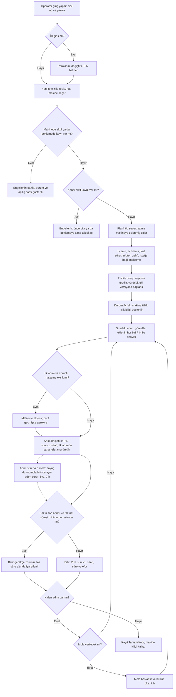

### 7.b Kayıt açma, makine kilidi ve eşzamanlı çakışma

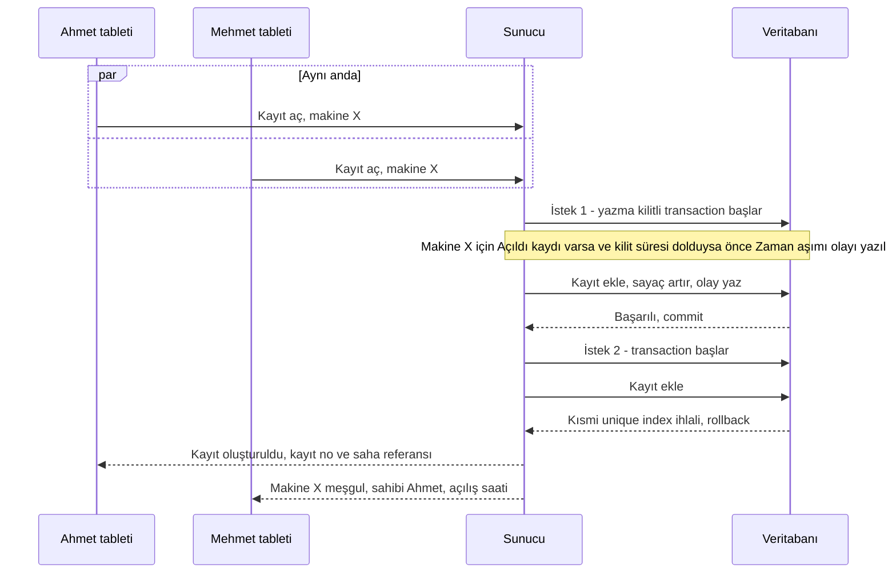

### 7.c Adım çalıştırma ve görevli ekleme

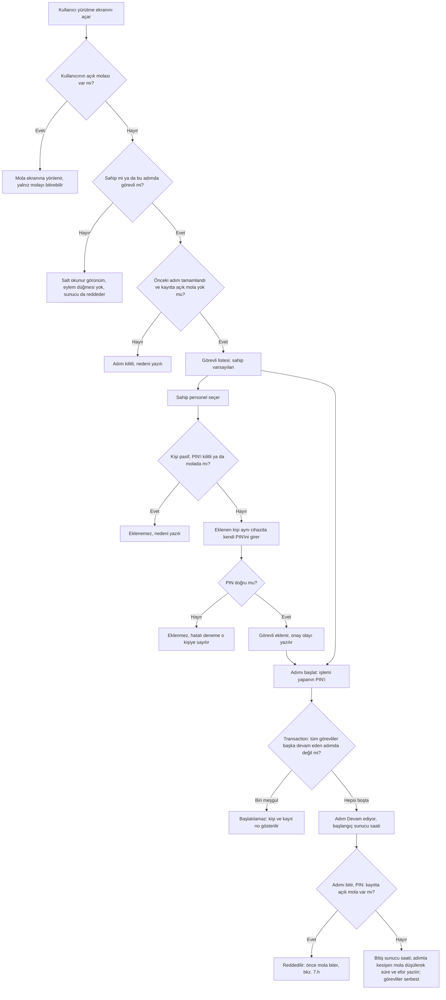

### 7.d Talep ve yönetici müdahalesi

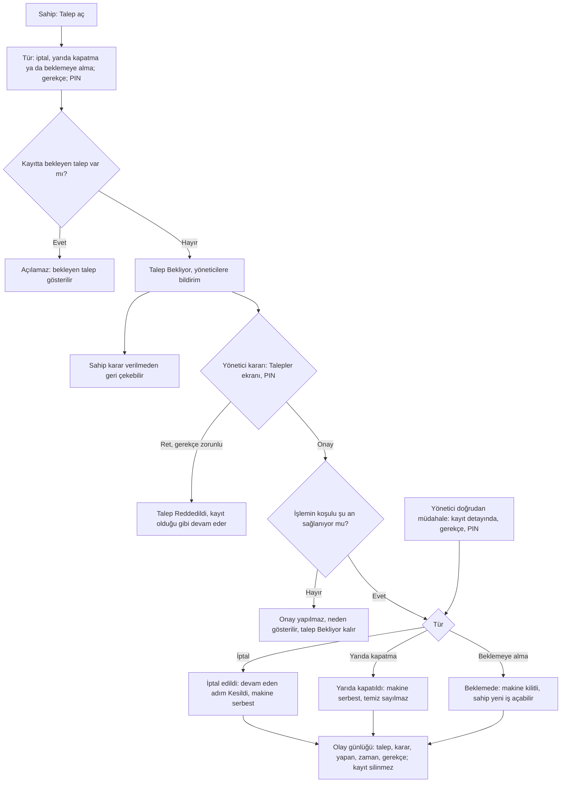

Ayrılan sahip (SC-16): yönetici kaydı yarıda kapatır, sonra kişiyi pasifleştirir (BR-36); yeni sorumlu yeni kayıt açar ve temizlik baştan yapılır.

### 7.e Tanım versiyonlama

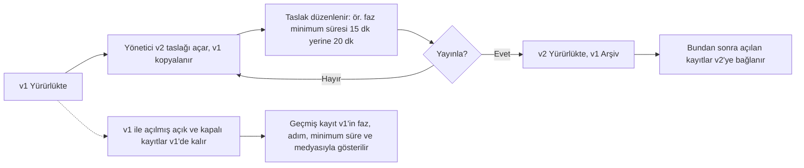

### 7.f Durum diyagramları

**Temizlik kaydı**

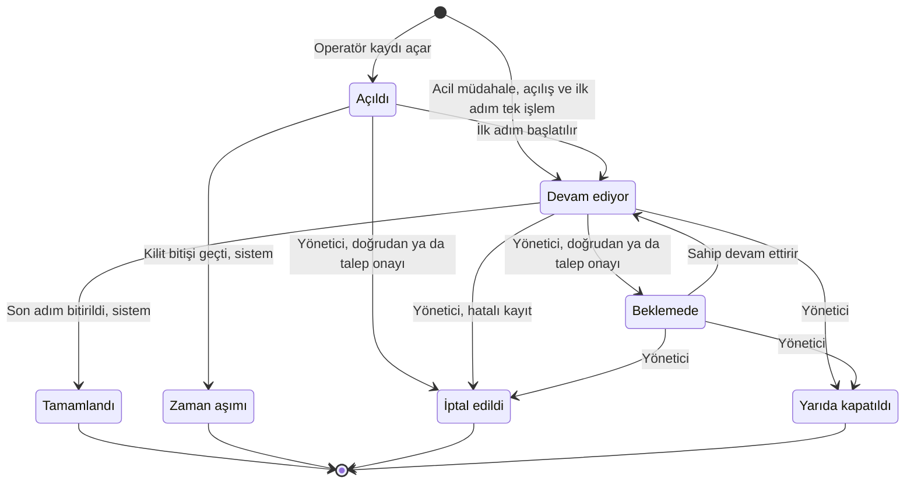

**Faz**

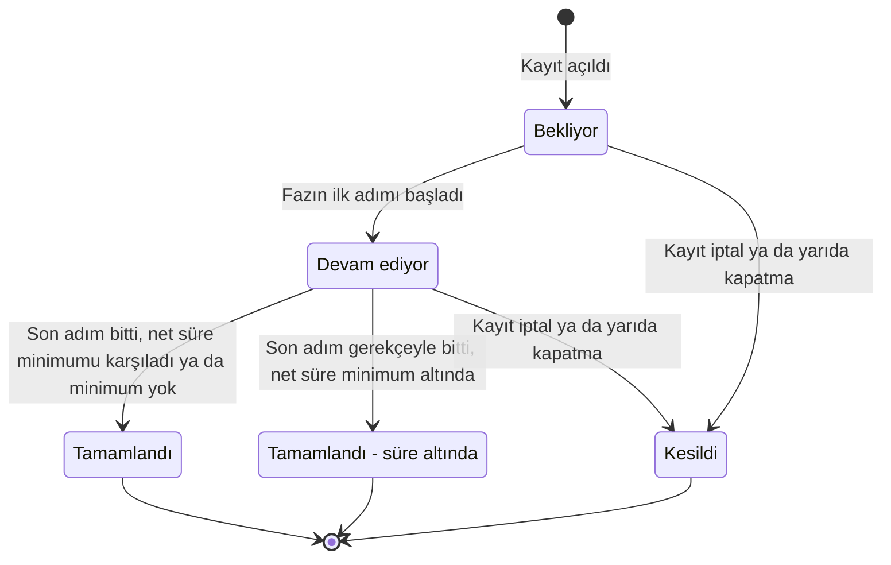

**Adım**

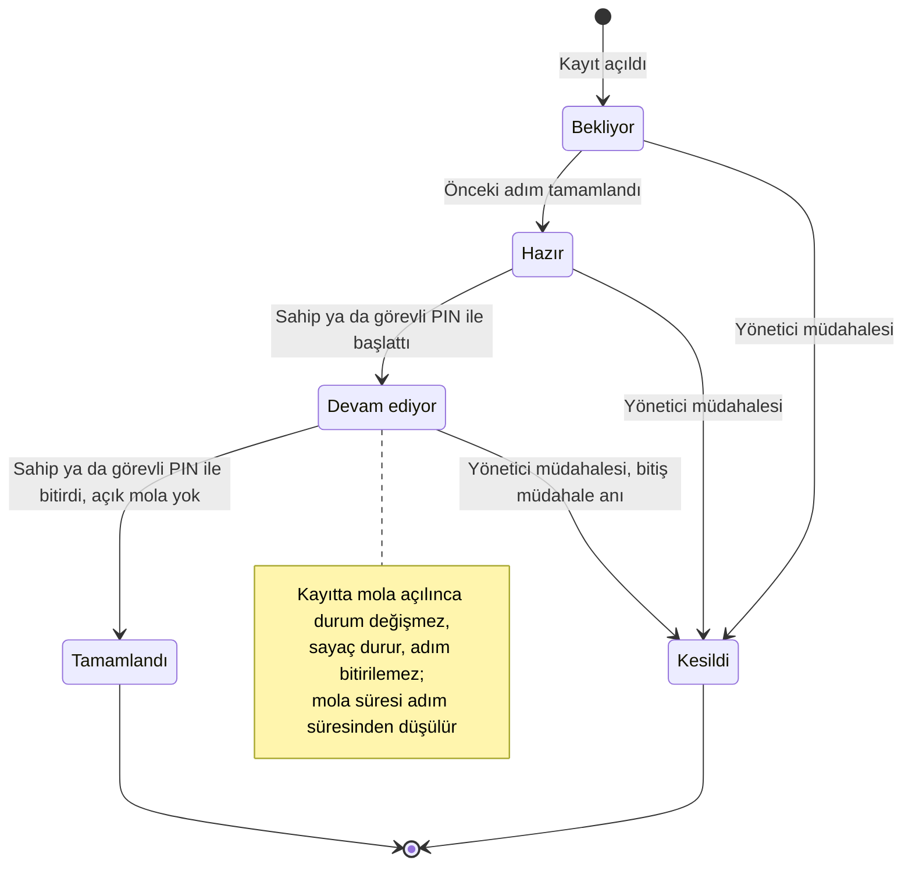

**Talep**

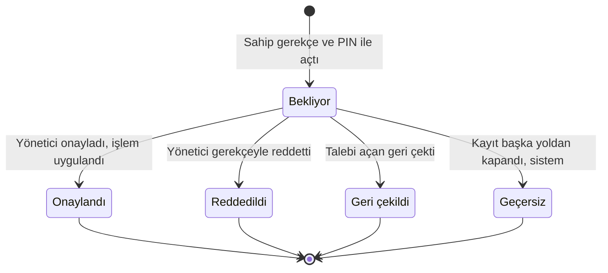

### 7.g Veri modeli taslağı (öneri; şema kararı dbadmin'indir)

```mermaid
erDiagram
    Facility ||--o{ ProductionLine : "içerir"
    Facility ||--o{ Shift : "vardiyalar"
    ProductionLine ||--o{ Machine : "içerir"
    Machine ||--o{ MachineCleaningType : "uygun tipler"
    CleaningType ||--o{ MachineCleaningType : "uygulanır"
    CleaningType ||--o{ ProcedureVersion : "versiyonlanır"
    ProcedureVersion ||--o{ ProcedurePhase : "fazlar"
    ProcedurePhase ||--o{ ProcedureStep : "adımlar"
    ProcedureStep ||--o{ StepMedia : "medya"
    Material ||--o{ MaterialLot : "lotlar"
    Machine ||--o{ CleaningRecord : "temizlenir"
    ProcedureVersion ||--o{ CleaningRecord : "uygulanır"
    User ||--o{ CleaningRecord : "sahibi"
    CleaningRecord ||--o{ RecordPhase : "faz yürütmeleri"
    ProcedurePhase ||--o{ RecordPhase : "tanımı"
    RecordPhase ||--o{ RecordStep : "adım yürütmeleri"
    ProcedureStep ||--o{ RecordStep : "tanımı"
    RecordStep ||--o{ StepParticipant : "görevliler"
    User ||--o{ StepParticipant : "çalışır"
    CleaningRecord ||--o{ RecordMaterial : "kullanılan malzeme"
    MaterialLot ||--o{ RecordMaterial : "lot"
    CleaningRecord ||--o{ RecordBreak : "molalar"
    CleaningRecord ||--o{ RecordRequest : "talepler"
    CleaningRecord ||--o{ RecordHold : "beklemeler"
    CleaningRecord ||--o{ CleaningEvent : "olay günlüğü"
    User ||--o{ CleaningEvent : "yapan"
    Notification ||--o{ NotificationReceipt : "okuyanlar"
    User ||--o{ NotificationReceipt : "alır"
    SystemSetting ||--o{ SettingChange : "geçmiş"
    User ||--o{ SettingChange : "değiştirir"

    SystemSetting {
        string Key PK "Beş ayar, medya boyutu fotoğraf ve video ayrı"
        int Value "Birim anahtarda: dakika ya da MB"
    }
    SettingChange {
        int Id PK
        string SettingKey FK
        int OldValue
        int NewValue
        int ChangedByUserId FK
        datetime ChangedAtUtc
    }

    Facility {
        int Id PK
        string Code UK
        string Name
        bool IsActive
    }
    Shift {
        int Id PK
        int FacilityId FK
        string Name
        time StartTime
        time EndTime "StartTime'dan küçükse ertesi gün"
        bool IsActive
    }
    ProductionLine {
        int Id PK
        int FacilityId FK
        string Code
        string Name
        bool IsActive
    }
    Machine {
        int Id PK
        int ProductionLineId FK
        string Code
        string Name
        bool IsActive
        datetime RetiredAtUtc
    }
    CleaningType {
        int Id PK
        string Code UK
        string Name
        int Kind "Planlı, Acil"
        int DefaultLockMinutes "Yalnız planlı"
        bool IsActive
    }
    MachineCleaningType {
        int MachineId PK
        int CleaningTypeId PK
    }
    ProcedureVersion {
        int Id PK
        int CleaningTypeId FK
        int VersionNo
        int Status "Taslak, Yürürlükte, Arşiv"
        bool MaterialRequired
        datetime PublishedAtUtc
        int PublishedByUserId FK
    }
    ProcedurePhase {
        int Id PK
        int ProcedureVersionId FK
        int OrderNo
        string Title
        int MinDurationSeconds "Acil tipte boş"
    }
    ProcedureStep {
        int Id PK
        int ProcedurePhaseId FK
        int OrderNo
        string Title
        string Description
    }
    StepMedia {
        int Id PK
        int ProcedureStepId FK
        string MediaType
        string Sha256 "İçerik adresi"
        string OriginalFileName
    }
    Material {
        int Id PK
        string Code UK
        string Name
        bool IsActive
    }
    MaterialLot {
        int Id PK
        int MaterialId FK
        string LotNo
        datetime ExpiryDate
    }
    User {
        int Id PK
        string RegistryNo UK "Sicil"
        string FullName
        string PasswordHash
        bool MustChangePassword
        string PinHash "Boşsa ilk girişte belirlenir"
        int PinFailedCount
        datetime PinLockedAtUtc
        bool IsActive
    }
    CleaningRecord {
        int Id PK
        string RecordNo UK
        string FieldBookRef UK "Planlıda ilk adımda dolar"
        int Kind "Planlı, Acil"
        int Status
        int MachineId FK
        int ProcedureVersionId FK
        int OwnerUserId FK "Kısmi unique index"
        string FacilitySnapshot "Kod ve ad"
        string LineSnapshot "Kod ve ad"
        string MachineSnapshot "Kod ve ad"
        string WorkOrderNo
        string Note
        string EmergencyDescription "Acilde zorunlu"
        int LockMinutes
        datetime LockExpiresAtUtc
        datetime OpenedAtUtc
        datetime StartedAtUtc
        datetime CompletedAtUtc
        datetime ClosedAtUtc "Zaman aşımı, iptal, yarıda kapatma"
        int GrossSeconds
        int BreakSeconds
        int HoldSeconds
        int NetSeconds
        int EffortSeconds
        int Version "Eşzamanlılık belirteci"
    }
    RecordPhase {
        int Id PK
        int CleaningRecordId FK
        int ProcedurePhaseId FK
        int Status
        int MinDurationSecondsSnapshot
        int GrossSeconds
        int BreakSeconds
        int HoldSeconds
        int NetSeconds
        bool BelowMinimum
        string BelowMinimumReason
    }
    RecordStep {
        int Id PK
        int RecordPhaseId FK
        int ProcedureStepId FK
        int Status
        datetime StartedAtUtc
        int StartedByUserId FK
        datetime EndedAtUtc
        int EndedByUserId FK
        int BreakSeconds "SH-17"
        int DurationSeconds "SH-01"
        int EffortSeconds "SH-02"
    }
    StepParticipant {
        int Id PK
        int RecordStepId FK
        int UserId FK
        bool IsWorking "Kısmi unique index"
        int AddedByUserId FK
        datetime ConfirmedAtUtc "Kendi PIN'iyle onay"
    }
    RecordMaterial {
        int Id PK
        int CleaningRecordId FK
        int MaterialLotId FK
        string MaterialCodeSnapshot
        string LotNoSnapshot
        datetime ExpiryDateSnapshot
        bool ExpiredAtEntry
        string ExpiredReason
        int EnteredByUserId FK
        datetime EnteredAtUtc
        datetime RemovedAtUtc "Yalnız ilk adımdan önce"
    }
    RecordBreak {
        int Id PK
        int CleaningRecordId FK "Açık mola için kısmi unique"
        int StartedByUserId FK "Açık mola için kısmi unique"
        int RecordStepId FK "Mola başlarken devam eden adım, boş olabilir"
        datetime StartedAtUtc
        datetime EndedAtUtc
        int EndedByUserId FK
        int EndKind "Kişi, Yönetici, Müdahale"
        string EndReason
    }
    RecordRequest {
        int Id PK
        int CleaningRecordId FK "Bekleyen talep için kısmi unique"
        int Type "İptal, Yarıda kapatma, Beklemeye alma"
        string Reason
        int RequestedByUserId FK
        datetime RequestedAtUtc
        int Status "Bekliyor, Onaylandı, Reddedildi, Geri çekildi, Geçersiz"
        int DecidedByUserId FK
        datetime DecidedAtUtc
        string DecisionNote
    }
    RecordHold {
        int Id PK
        int CleaningRecordId FK
        int RecordRequestId FK "Doğrudan müdahalede boş"
        datetime StartedAtUtc
        int StartedByUserId FK
        datetime EndedAtUtc
        int EndedByUserId FK
    }
    CleaningEvent {
        int Id PK
        int CleaningRecordId FK
        int Sequence "Kayıt içi sıra"
        string EventType
        string PayloadJson
        int ActorUserId FK
        datetime OccurredAtUtc
        string CommandId UK
        string PreviousHash
        string Hash
    }
    NumberSequence {
        string Scope PK "Makine ya da tesis"
        int Year PK
        int LastValue
    }
    Notification {
        int Id PK
        int Kind "Acil müdahale, Yeni talep"
        int CleaningRecordId FK
        int RecordRequestId FK
        datetime CreatedAtUtc
    }
    NotificationReceipt {
        int NotificationId PK
        int UserId PK
        datetime ReadAtUtc
    }
```

Not: Kullanıcı rolleri (`Operator`, `Manager`, `Auditor`, `SuperAdmin`) ayrı bir kullanıcı-rol tablosunda tutulur. Tablo ve kolon adları
dbadmin'in kararıdır; yukarıdakiler sözleşmeyi anlatmak içindir.

### 7.h Mola

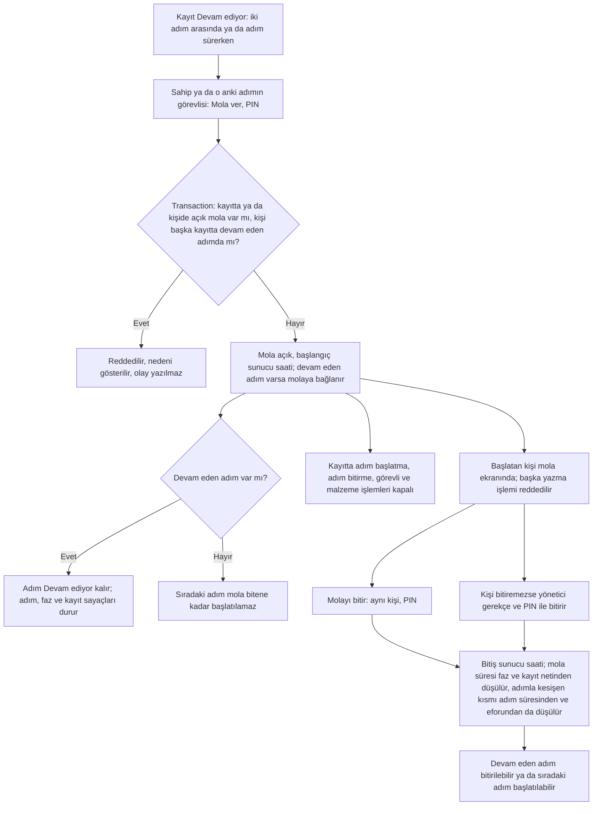

Mola, mola açıkken adım bitirilemediği ve başlatılamadığı için ya bütünüyle bir adımın içinde ya da bütünüyle iki adım arasındadır.
İçindeyse adım süresinden ve fazın netinden, aradaysa yalnız fazın (ya da iki faz arasındaysa yalnız kaydın) netinden düşülür.

### 7.i Beklemeye alma ve başka işe geçme

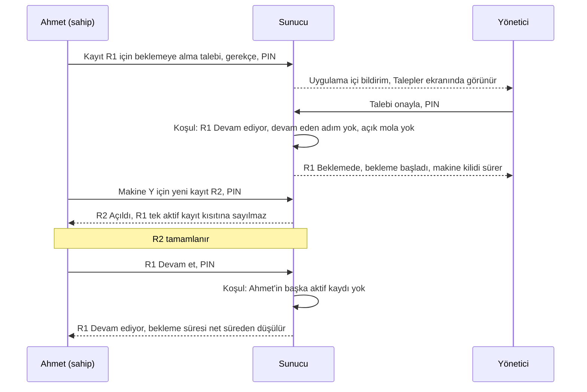

### 7.j Acil müdahale

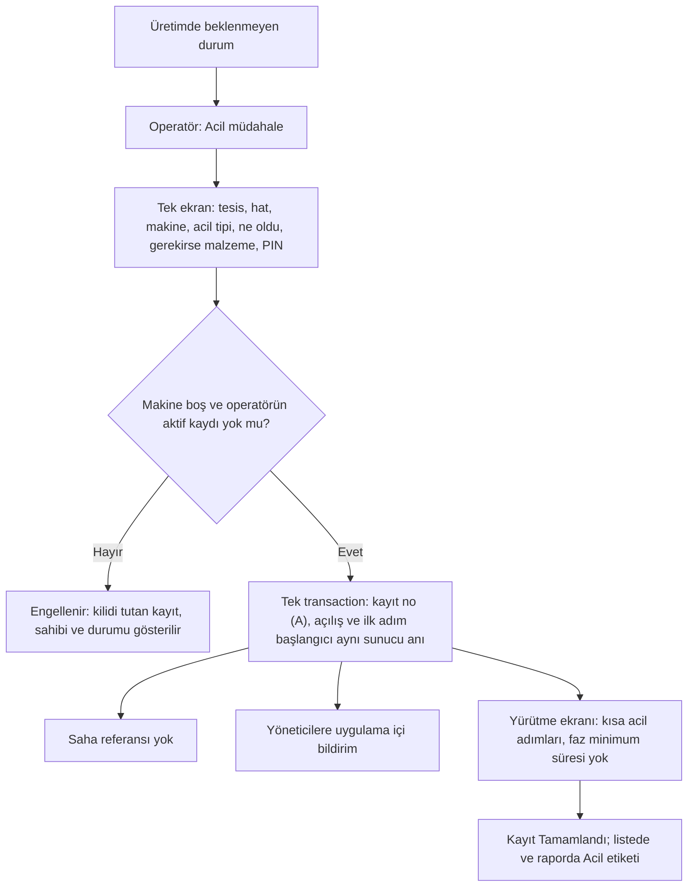

---

## 8. Öngörülen senaryolar

Değeri iş biriminden gelecek yerler `<...>` ile gösterilmiştir. Örneklerdeki 15 dakika, 20 dakika, 12 saniye, 40 dakika ve "10 dk x 2 kişi = 20 dk"
değerleri dokümandan alınmıştır (satır 17-18, 28, 61-71); saat değerleri hesabı göstermek içindir.

**SC-01: Planlı temizlik, mutlu yol**
- Verilen: Operatör Ahmet giriş yapmış; makine X'in açık kaydı yok; tip T makineye eşli, yürürlükte v1 var (3 faz), malzeme zorunlu değil.
- Ne zaman: Ahmet planlı kayıt açar, her adımı sırayla başlatıp bitirir.
- O zaman: Kayıt no ve saha referansı oluşur ve gösterilir; kayıt "Açıldı", ilk adım başlayınca "Devam ediyor", son adım bitince "Tamamlandı" olur; tüm zamanlar sunucu saatidir; detayda 13 sorunun yanıtı vardır; makine kilidi kalkar.

**SC-02: Acil müdahale (K-14)**
- Verilen: "Acil" türünde yürürlükte versiyonu olan bir tip var; makine X boş; operatörün aktif kaydı yok.
- Ne zaman: Operatör Acil müdahale ekranında makine X'i ve acil tipini seçer, ne olduğunu yazar, PIN girer.
- O zaman: Tek işlemde kayıt açılır ve ilk adım başlar, iki zaman aynıdır; kayıt numarası `A` tür harfini taşır; saha referansı oluşmaz ve alan "yok" olarak gösterilir; yöneticilere bildirim düşer; fazlarda minimum süre kontrolü yoktur; kayıt listede ve raporda "Acil" etiketiyle ayrılır. Açıklama boşsa kayıt açılmaz.

**SC-03: Vardiya bitimi ve devam**
- Verilen: Ahmet'in kaydında 2. fazın 1. adımı tamamlanmış, sıradaki adım başlamamış.
- Ne zaman: Ahmet oturumu kapatır, ertesi vardiyada giriş yapar.
- O zaman: Kayıt "Devam ediyor" durumunda kalmıştır, sistem kapatmamıştır; İşlerim ekranında görünür; Ahmet sıradaki adımdan devam eder; makine bu süre boyunca kilitlidir. Ahmet çıkmadan mola vermediyse aradaki süre net süreye çalışma olarak girer; mola verdiyse girişte önce molayı bitirir ve süre net süreden düşülür.

**SC-04: Aynı makine için eşzamanlı kayıt açma**
- Verilen: Makine X boş; Ahmet ve Mehmet sihirbazda makine X'i seçmiş.
- Ne zaman: İkisi aynı anda "Kaydı oluştur" gönderir.
- O zaman: Yalnız bir kayıt oluşur; diğer kullanıcı "Makine X'te açık kayıt var" mesajını, sahibin adı ve açılış saatiyle alır; veritabanında makine X için tek aktif kayıt vardır.

**SC-05: Personel çakışması**
- Verilen: Ahmet, Mehmet'in kaydında bir adımda görevli ve adım "Devam ediyor"; Ahmet'in kendi açtığı başka bir kaydı var.
- Ne zaman: Ahmet kendi kaydında bir adımı başlatmaya çalışır.
- O zaman: Adım başlamaz; mesaj Ahmet'in hangi kayıtta çalıştığını gösterir; Mehmet'in kaydındaki adım bitince Ahmet kendi adımını başlatabilir.

**SC-06: 12 saniye + 40 dakika bekleme (K-02)**
- Verilen: Faz 1 minimum süresi 15 dakika, iki adımlı.
- Ne zaman: Adım 1 10:00:00'da başlar, 10:00:12'de biter; operatör 40 dakika ayrılır; adım 2 10:40:12'de başlar ve `d` süre sonra biter. (a) Operatör ayrılmadan mola vermemiştir. (b) Ayrılırken mola verip dönünce bitirmiştir.
- O zaman: Faz brüt süresi iki durumda da 40 dk 12 sn + `d`. (a) Net = brüt; minimum karşılanır. (b) Net = brüt - mola süresi; net 15 dakikanın altındaysa son adım gerekçeyle bitirilir ve faz "Tamamlandı - süre altında" olur (SC-30). Raporda brüt, mola ve net ayrı görünür.

**SC-07: Malzeme zorunluluğunu atlama girişimi**
- Verilen: Tip T'nin yürürlükteki versiyonunda malzeme zorunlu.
- Ne zaman: Operatör malzeme girmeden ilerlemeye çalışır (arayüzde ya da istek değiştirilerek doğrudan sunucuya).
- O zaman: Kayıt malzemesiz açılabilir; ilk adımı başlatma isteği sunucuda reddedilir (BR-11); atlama seçeneği yoktur; reddedilen istek olay üretmez.

**SC-08: SKT geçmiş malzeme**
- Verilen: Lot L'nin SKT'si sunucu tarihine göre dün.
- Ne zaman: Operatör L'yi seçmeye çalışır.
- O zaman: L listede "SKT geçmiş" uyarısıyla görünür; seçilince gerekçe alanı zorunlu olur; gerekçesiz istek reddedilir; gerekçeyle eklenen malzeme satırı kayıt detayında, denetim çıktısında ve raporda "SKT geçmiş" işaretiyle görünür (K-12).

**SC-09: Yetkisiz kişinin adım başlatması**
- Verilen: Ahmet'in kaydı; Mehmet o kayıtta görevli değil.
- Ne zaman: Mehmet kaydı açar ve adım başlatma isteği gönderir.
- O zaman: Mehmet kaydı görür (K-17 kapsamında) ama başlat/bitir düğmeleri yoktur; doğrudan gönderilen istek reddedilir (403 ya da açıklayıcı mesaj); adım durumu değişmez.

**SC-10: Hatalı makine seçimi**
- Verilen: Ahmet makine Y yerine yanlışlıkla makine X için kayıt açmış.
- Ne zaman: (a) Hiçbir adım başlamamışken fark eder; (b) adım başlattıktan sonra fark eder.
- O zaman: Ahmet kaydı kendisi iptal edemez; gerekçeli iptal talebi açar (K-05). (a) Yönetici onaylar ya da kilit bitişinde kayıt zaman aşımına düşer; (b) yönetici talebi onaylar ya da doğrudan gerekçeyle iptal eder. Her durumda kayıt silinmez, "İptal edildi" (ya da "Zaman aşımı") görünür, kayıt no ve varsa saha referansı yeniden kullanılmaz, makine X serbest kalır.

**SC-11: Tanım değişikliği sonrası eski kaydın görüntülenmesi**
- Verilen: Geçen ay v1 (faz minimum 15 dk) ile tamamlanmış kayıt; bugün v2 (20 dk) yayınlandı ve 2. adımın açıklaması değişti.
- Ne zaman: Yönetici eski kaydı açar.
- O zaman: Kayıt v1 olarak etiketlidir; faz minimum süresi 15 dk, adım açıklaması eski metin ve eski medya görünür; uyum değerlendirmesi v1'e göredir.

**SC-12: Makinenin kullanımdan kaldırılması**
- Verilen: Makine X'in tamamlanmış geçmiş kayıtları var, açık kaydı yok.
- Ne zaman: Yönetici makine X'i kullanımdan kaldırır.
- O zaman: X yeni kayıt sihirbazında görünmez ya da "kullanımdan kaldırıldı" olarak seçilemez; geçmiş kayıtlar X'in adı ve koduyla görüntülenir ve raporlanır; açık kaydı varsa davranış K-25.

**SC-13: Geriye dönük değiştirme girişimi**
- Verilen: Ahmet bir adıma bugün 10:05'te başladı.
- Ne zaman: Ertesi gün Ahmet ya da yönetici başlangıcı 09:30 yapmak ister.
- O zaman: Hiçbir ekranda zaman düzenleme alanı yoktur; böyle bir istek sunucuda karşılık bulmaz; düzeltme olayı yalnız zaman dışı alanlar için ve gerekçeyle mümkündür (K-16); orijinal değer her zaman görünür.

**SC-14: Denetim raporu alma**
- Verilen: Tamamlanmış planlı kayıt.
- Ne zaman: Yönetici (ya da denetçi) kaydın denetim çıktısını alır.
- O zaman: Çıktı 13 sorunun tamamını, olay günlüğünü, bütünlük doğrulama sonucunu ve prosedür versiyonunu içerir; yazdırılabilir görünüm ve CSV alınabilir (biçim K-28).

**SC-15: Başlamamış kaydın kilit süresinin dolması (K-03)**
- Verilen: Ahmet makine X için kayıt açtı; kilit bitişi açılışta gösterildi; Ahmet kilit bitişine kadar adım başlatmadı.
- Ne zaman: Mehmet makine X için kayıt açmak ister; ayrıca Ahmet aynı kayıtta ilk adımı başlatmak ister.
- O zaman: Ahmet'in kaydı kilit bitişi zamanıyla "Zaman aşımı" olur (olay yazılır) ve Mehmet'in kaydı oluşur; Ahmet'in isteği reddedilir. Kilit bitişinden önce istenirse Mehmet çakışma mesajı alır. Vardiya durumu SC-36.

**SC-16: Kayıt sahibinin işten ayrılması (K-04)**
- Verilen: Ahmet'in kaydı "Devam ediyor"; Ahmet başka bir kaydın başlamamış adımında görevli olarak listeli; Ahmet işten ayrıldı.
- Ne zaman: Yönetici Ahmet'i pasifleştirmek ister.
- O zaman: Pasifleştirme yapılmaz; ekran Ahmet'in açık kaydını ve görevli olduğu adımı bağlantılarıyla listeler. Yönetici kaydı gerekçeyle yarıda kapatır, diğer kaydın sahibi Ahmet'i adımdan çıkarır; bundan sonra pasifleştirme yapılır. Sahip hiçbir aşamada değişmez; makine serbest kalır; yeni sorumlu yeni kayıt açar.

**SC-17: Operatörün tanım ekranına erişimi**
- Verilen: Operatör rolündeki kullanıcı oturum açmış.
- Ne zaman: Makine, prosedür, malzeme ya da kullanıcı ekranının adresine gider ya da form gönderir.
- O zaman: 403 sayfası görür; menüde bu bağlantılar yoktur; oturumsuz erişim giriş sayfasına yönlenir.

**SC-18: Sıra atlama girişimi**
- Verilen: Faz 1'in 2. adımı tamamlanmamış.
- Ne zaman: Operatör 3. adımı başlatmaya çalışır.
- O zaman: 3. adım kilitlidir; doğrudan istek reddedilir (K-06, katı sıra).

**SC-19: Adım bazlı görevli ve efor (satır 50, 61-62)**
- Verilen: Ahmet'in kaydı; Mehmet boşta.
- Ne zaman: 1. adımda yalnız Ahmet; 2. adıma Mehmet eklenir ve kendi PIN'iyle onaylar, adım 10:00'da başlar 10:10'da biter; 3. adımda Ahmet listeden çıkarılır, yalnız Mehmet çalışır.
- O zaman: 2. adımın süresi 10 dk, eforu 20 dk; 3. adımı Mehmet (görevli) ya da Ahmet (sahip) başlatabilir, efor yalnız Mehmet'e yazılır; detayda her adımın görevlileri ayrı görünür.

**SC-20: Açık kayıt varken yeni versiyon yayınlanması**
- Verilen: v1 ile açılmış kayıt "Devam ediyor".
- Ne zaman: Yönetici v2'yi yayınlar.
- O zaman: Açık kayıt v1 ile devam eder ve tamamlanır; yeni açılan kayıtlar v2'ye bağlanır.

**SC-21: Veritabanında doğrudan değişikliğin tespiti**
- Verilen: Tamamlanmış kayıt; biri veritabanı dosyasında bir adımın zamanını ya da bir olay satırını değiştirmiş.
- Ne zaman: Yönetici ya da denetçi bütünlük doğrulamasını çalıştırır.
- O zaman: Kayıt "Bütünlük ihlali" olarak gösterilir ve tutarsız olay belirtilir. Olay günlüğü satırının uygulama üzerinden güncellenmesi ya da silinmesi veritabanı tarafından reddedilir.

**SC-22: Lot bazlı geriye izleme (satır 24)**
- Verilen: Lot L üç ayrı kayıtta kullanılmış.
- Ne zaman: Yönetici lot L ile arama yapar ya da makine X'in malzeme geçmişine bakar.
- O zaman: L'nin kullanıldığı kayıtlar makine, tarih ve kayıt no ile listelenir; makine X için kullanılan malzeme ve lotlar tarih sırasıyla görünür.

**SC-23: Aynı komutun iki kez gönderilmesi**
- Verilen: Zayıf bağlantı.
- Ne zaman: Operatör "Başlat"a iki kez dokunur ya da tarayıcı isteği yeniden gönderir.
- O zaman: Tek başlangıç olayı oluşur; ikinci istek ilk sonucun aynısını döner.

**SC-24: Denetçinin salt okunur erişimi (K-48)**
- Verilen: Denetçi rolündeki kullanıcı.
- Ne zaman: Kayıtları, raporları ve bütünlük ekranını açar; müdahale ya da tanım formu gönderir.
- O zaman: Okuma ekranları açılır; yazma istekleri 403 döner.

**SC-25: Mola, mutlu yol**
- Verilen: Ahmet'in kaydı "Devam ediyor"; 1. fazın 1. adımı bitmiş, 2. adım başlamamış.
- Ne zaman: Ahmet PIN ile "Mola ver" der; bir süre sonra PIN ile "Molayı bitir" der; 2. adımı başlatır.
- O zaman: Mola başlangıç ve bitişi sunucu saatidir; mola süresi fazın ve kaydın net süresinden düşülür, brüt süreden düşülmez; kayıt detayında mola satırı başlatan kişi, iki zaman ve süreyle görünür.

**SC-26: Mola açıkken işlem girişimi**
- Verilen: Ahmet kendi kaydında molada; Mehmet aynı kaydın sıradaki adımında görevli. İkinci durumda mola, Ahmet ve Mehmet'in birlikte çalıştığı adım sürerken açılmıştır.
- Ne zaman: Ahmet başka bir kayıtta adım başlatmak ya da yeni kayıt açmak ister; Mehmet aynı kayıtta sıradaki adımı başlatmak ister. İkinci durumda Mehmet devam eden adımı bitirmek ister.
- O zaman: Ahmet'in istekleri reddedilir ve mola ekranına yönlenir; Mehmet'in başlatma ve bitirme istekleri "kayıtta açık mola var" nedeniyle reddedilir, adım "Devam ediyor" kalır; hiçbir istek olay üretmez.

**SC-27: Beklemeye alma ve başka işe geçme (7.i)**
- Verilen: Ahmet'in kaydı R1 "Devam ediyor", devam eden adım ve açık mola yok.
- Ne zaman: Ahmet beklemeye alma talebi açar, yönetici onaylar; Ahmet makine Y için R2 açar ve tamamlar; R1'e "Devam et" der.
- O zaman: R1 "Beklemede" olur, makinesi kilitli kalır; R2 açılabilir; R1 devam ettiğinde bekleme süresi R1'in net süresinden düşülür; talep, onay ve bekleme olayları R1'in günlüğündedir.

**SC-28: Talebin reddi ve geri çekilmesi**
- Verilen: Ahmet'in kaydında bekleyen iptal talebi var.
- Ne zaman: (a) Yönetici gerekçe yazmadan reddetmek ister; (b) gerekçeyle reddeder; (c) başka bir talepte Ahmet karar verilmeden geri çeker.
- O zaman: (a) reddedilir, "gerekçe zorunlu"; (b) talep "Reddedildi", kayıt olduğu gibi devam eder, Ahmet Taleplerim ekranında kararı ve gerekçeyi görür; (c) talep "Geri çekildi", yönetici listesinde karar düğmeleri yoktur.

**SC-29: İkinci aktif kayıt girişimi**
- Verilen: Ahmet'in sahibi olduğu bir kayıt "Açıldı" ya da "Devam ediyor".
- Ne zaman: Ahmet başka bir makine için kayıt açmak ister (arayüzde ya da doğrudan istekle).
- O zaman: Kayıt açılmaz; mesaj mevcut aktif kaydı numarasıyla gösterir ve beklemeye alma talebine bağlantı verir; veritabanında Ahmet'in tek aktif kaydı vardır.

**SC-30: Faz minimum süresinin altında bitirme (K-01)**
- Verilen: Faz minimumu 15 dakika; fazın son adımı devam ediyor; faz net süresi bu anda 15 dakikanın altında.
- Ne zaman: Görevli gerekçesiz "Bitir" gönderir, sonra gerekçeyle yeniden gönderir.
- O zaman: İlk istek reddedilir ve olay üretmez; ikinci istekle adım biter, bitiş zamanı ikinci isteğin sunucu saatidir; faz "Tamamlandı - süre altında" olur, gerekçe detayda ve raporda görünür.

**SC-31: Hatalı PIN**
- Verilen: Ahmet'in PIN'i kilitli değil.
- Ne zaman: Adım başlatırken art arda `<PinDenemeSınırı>` kez yanlış PIN girer.
- O zaman: Hiçbir denemede adım başlamaz ve olay yazılmaz; son denemede PIN kilitlenir ve oturum kapanır; Ahmet girişten sonra PIN isteyen işlem yapamaz; yönetici PIN'i sıfırlayınca Ahmet yeni PIN belirler.

**SC-32: Yardımcının PIN ile katılım onayı (K-10)**
- Verilen: Ahmet'in kaydında 2. adım başlamadı; Mehmet aynı cihazın başında.
- Ne zaman: Ahmet Mehmet'i görevli seçer; Mehmet kendi PIN'ini girer. Başka bir denemede Mehmet yanlış PIN girer.
- O zaman: Doğru PIN'le Mehmet görevli olur, olay "ekleyen Ahmet, onaylayan Mehmet" bilgisini taşır; yanlış PIN'de Mehmet eklenmez ve hatalı deneme Mehmet'in sayacına yazılır.

**SC-33: Bağlantı yokken işlem (K-15)**
- Verilen: Operatör yürütme ekranında, ağ bağlantısı kesik.
- Ne zaman: "Başlat"a dokunur.
- O zaman: Ekran isteğin sunucuya ulaşmadığını ve işlemin yapılmadığını gösterir; adım durumu değişmez; bağlantı gelince yeniden deneme aynı komut kimliğiyle gider ve tek başlangıç olayı oluşur.

**SC-34: İlk giriş**
- Verilen: Yönetici Ahmet'i geçici parolayla oluşturdu.
- Ne zaman: Ahmet ilk kez giriş yapar ve İşlerim adresine gitmek ister.
- O zaman: Parola değiştirme ve PIN belirleme ekranına yönlenir; ikisi bitmeden başka ekran açılmaz; bittikten sonra İşlerim açılır.

**SC-35: Koşulu sağlanmayan talep onayı**
- Verilen: Ahmet'in kaydında bekleyen beklemeye alma talebi var; Ahmet bu arada bir adımı başlattı.
- Ne zaman: Yönetici talebi onaylar.
- O zaman: Onay yapılmaz, "kayıtta devam eden adım var" mesajı gösterilir; talep "Bekliyor" kalır; adım bitince onay yapılabilir.

**SC-36: Vardiya bitimine denk gelen kilit (K-38 varsayılanı)**
- Verilen: Tesisin vardiyası `<VardiyaBitişi>` saatinde bitiyor; tip kilit süresi `<KilitSüresi>`; Ahmet kaydı, açılış + kilit süresi vardiya bitişini geçecek bir saatte açıyor.
- Ne zaman: Vardiya biter, ilk adım başlamamıştır; sonraki vardiyadan Mehmet aynı makine için kayıt açmak ister.
- O zaman: Kayıt oluşturulurken kilit bitişi vardiya bitişi olarak gösterilmiştir; Ahmet'in kaydı vardiya bitişi zamanıyla "Zaman aşımı" olur; Mehmet'in kaydı açılır.

**SC-37: Adım sürerken mola (K-39)**
- Verilen: Ahmet'in kaydı "Devam ediyor"; bir adımda Ahmet ve Mehmet görevli; adım 10:00:00'da başladı.
- Ne zaman: Ahmet 10:04:00'te PIN ile "Mola ver" der; 10:44:00'te PIN ile molayı bitirir; adım 10:50:00'de bitirilir.
- O zaman: Mola süresince adım "Devam ediyor" kalır, ekrandaki sayaçlar durur, adım bitirilemez. Adım molası 40 dk (SH-17); adım süresi = 50 dk - 40 dk = 10 dk (SH-01); efor = 10 dk x 2 = 20 dk (SH-02). Mola fazın ve kaydın net süresinden de 40 dk düşülür, brüt süreler değişmez. Detayda mola satırı başlatan kişi, iki zaman, süre ve sürdüğü adımla görünür.
- Ayrıca: Ahmet bu adımın görevli listesinden çıkarılmış ve o anda başka bir kayıtta devam eden bir adımda çalışıyor olsaydı, bu kayıtta mola başlatma isteği reddedilirdi (BR-38).

**SC-38: Süper admin ve yönetici hesapları (PL-05)**
- Verilen: Kurulumda yalnız seed'deki Süper admin var.
- Ne zaman: Süper admin ilk girişini tamamlar, bir Yönetici hesabı açar; Yönetici bir Operatör açar; Yönetici başka bir Yönetici'nin PIN'ini sıfırlamak ister; Süper admin kendini pasifleştirmek ister.
- O zaman: Yönetici ve Operatör geçici parolayla açılır ve ilk girişte parola ve PIN belirler. Yönetici'nin isteği reddedilir; aynı sıfırlamayı Süper admin PIN'iyle yapar. Kendini pasifleştirme ve son aktif Süper admin'i pasifleştirme reddedilir. Süper admin kayıt, makine panosu, tanım ve rapor adreslerinde 403 alır.

---

## 9. Teknik yaklaşım önerileri

Tümü `CLAUDE.md` ve `Docs/Process/*.md` kısıtlarıyla uyumludur (MVC + EF Core + SQLite, rol bazlı yetki, CQRS/MediatR/kuyruk yok, DROP yok).

### 9.1 Değiştirilemezlik

| Öneri | Gerekçe | Alternatif |
|---|---|---|
| **Ekleme-only olay günlüğü** (`CleaningEvents`): her durum değiştiren işlem bir satır; kayıt içi `Sequence` ile `(CleaningRecordId, Sequence)` unique. | "Kim, ne zaman, ne yaptı" (129) doğrudan karşılanır; olay sırası kanıtlanır. | Yalnız durum tabloları + `UpdatedAt` alanları: kim ne değiştirdi kaybolur, denetim için yetersiz. |
| **SQLite tetikleyicileri**: `CleaningEvents` üzerinde `BEFORE UPDATE` ve `BEFORE DELETE` -> `RAISE(ABORT)`; `RecordSteps` üzerinde dolu `StartedAtUtc` / `EndedAtUtc` değişirse `RAISE(ABORT)`; yayınlanmış versiyon alt tablolarında değişiklik `RAISE(ABORT)`. Yeni tablo ile birlikte eklemeli migration'da oluşturulur. | Uygulama hatası ya da hatalı kodla değişikliği veritabanı düzeyinde durdurur; DbProtocol "eklemeli" sınıfına girer. | Yalnız servis kuralı: kod hatasına açık. |
| **Hibrit model**: durum tabloları (`CleaningRecords`, `RecordSteps`) ekran ve rapor için okunabilir projeksiyon; olaylar ile aynı transaction'da yazılır. | Raporlama basit SQL ile yapılır; standartlarda CQRS yasak. | Saf event sourcing (durum yalnız olaylardan türetilir): kanıt gücü yüksek ama sorgu ve ekip maliyeti büyük, standartlara aykırıya yakın. |
| **Kayıt başına özet zinciri**: `Hash = HMAC-SHA256(anahtar, PreviousHash + kanonik olay)`; anahtar veritabanı ve `appsettings.json` dışında (ortam değişkeni / user-secrets). | Dosyaya erişen biri bir satırı değiştirirse zincir kırılır; anahtar olmadan zinciri yeniden hesaplayamaz (122). | Düz SHA-256 zinciri: anahtar yönetimi gerekmez ama tüm zincir yeniden hesaplanabilir. Ek güvence: zincir başlarının periyodik dışa aktarılıp ayrı saklanması (dış çapa, K-23). |
| **Sunucu saati tek kaynak**: zaman yalnız sunucuda `TimeProvider` ile alınır; komut ViewModel'lerinde zaman alanı bulunmaz; UTC saklanır. | 55-57, 127; istemci saati değiştirilebilir. | Veritabanı saati: SQLite gömülü olduğundan uygulama sunucusunun saatiyle aynıdır, ayrı kaynak değildir. Sunucunun NTP ile eşitlenmesi BT işidir (K-32). |
| **Düzeltme olayı**: güncelleme/silme yerine `CorrectionRecorded` (hedef olay, alan, eski, yeni, gerekçe). Zaman alanları düzeltilemez. | 126-128 ile gerçek hayat hatası (yanlış lot) arasında denge; orijinal her zaman görünür. | Hiç düzeltme olmaması: yanlış lot yanlış kalır, yalnız kayıt notuyla açıklanır (K-16). |

### 9.2 Eşzamanlılık

| Öneri | Gerekçe | Alternatif |
|---|---|---|
| **Makine kilidi = kısmi unique index**: `CleaningRecords(MachineId)` unique, filtre `Status IN (Açıldı, DevamEdiyor, Beklemede)` (EF Core `HasFilter`). | Satır 87: ekran kontrolü yetmez; iki eşzamanlı istekten yalnız biri yazılabilir. | Ayrı `MachineLocks` tablosu (MachineId PK): aynı garanti, ek tablo ve senkron yükü. |
| **Personel kilidi = kısmi unique index**: `StepParticipants(UserId)` unique, filtre `IsWorking = 1`; adım başlarken görevliler `IsWorking = 1`, bitince `0`. | Satır 76-77'nin veritabanı garantisi. | Uygulama içi kontrol: yarış durumunda iki adım aynı anda başlayabilir. |
| **Sahip kilidi = kısmi unique index**: `CleaningRecords(OwnerUserId)` unique, filtre `Status IN (Açıldı, DevamEdiyor)` (BR-37). | "Aynı anda tek iş" (K-08) eşzamanlı istekte de korunur. | Uygulama içi sayım: iki sekmeden aynı anda açmada iki kayıt oluşabilir. |
| **Açık mola ve bekleyen talep = kısmi unique index**: `RecordBreaks(CleaningRecordId)` ve `RecordBreaks(StartedByUserId)` filtre `EndedAtUtc IS NULL`; `RecordRequests(CleaningRecordId)` filtre `Status = Bekliyor`. | BR-40, BR-41 yarışta da korunur. | Uygulama içi kontrol. |
| **Yazma kilitli transaction**: açma, başlatma, bitirme tek transaction; SQLite'ta yazma kilidini baştan alan transaction, WAL modu, `busy_timeout`. | SQLite tek yazar; kontrol ve yazma arasında başka yazar giremez. | Varsayılan ertelenmiş transaction: kontrol ile yazma arasında kilit yükseltme hatası olasılığı. |
| **İyimser eşzamanlılık**: `CleaningRecords.Version` concurrency token; her durum değişiminde artar. | Aynı kaydın iki sekmeden/cihazdan aynı anda ilerletilmesini yakalar. | Yalnız unique `(CleaningRecordId, Sequence)`: aynı etki, daha geç hata. |
| **Komut kimliği (idempotency)**: her formda tek seferlik `CommandId`; `CleaningEvents.CommandId` unique. | Çift dokunma ve yeniden gönderme (SC-23). | Yalnız düğmeyi pasifleştirmek: istemci tarafı, yeterli değil. |
| **Kilit süresinin dolması tembel değerlendirilir**: kilit bitişi açılışta hesaplanıp kayıtta saklanır (SH-13); kayda ya da makineye dokunan her istekte ve pano sorgusunda kontrol edilir, aynı transaction'da "Zaman aşımı" olayı yazılır, zaman aşımı anı kilit bitişidir. | Arka plan altyapısı gerekmez; doğru kişiye izin verir (86). | `BackgroundService` ile periyodik tarama (kuyruk değildir, standartlarla uyumlu): pano anlık doğru olur, ek bileşen. |

### 9.3 Versiyonlama

- `ProcedureVersions(CleaningTypeId, VersionNo)` unique; durum Taslak / Yürürlükte / Arşiv; tip başına tek "Yürürlükte" (kısmi unique index).
- Yeni versiyon = son yayınlanmışın derin kopyası (faz, adım, medya bağlantısı); yayınlama tek transaction'da eskisini Arşiv yapar.
- Kayıt `ProcedureVersionId` taşır; detay ve rapor bu versiyondan okur (FR-09, SC-11, SC-20).
- Tesis/hat/makine ve lot için versiyon tablosu yerine kayıtta **açılış anı değerleri** saklanır (BR-06). Gerekçe: bu varlıklar seyrek değişir ve kayıtta yalnız ad/kod gerekir. Alternatif: bu varlıklar için de versiyon tabloları (ağır, raporu karmaşıklaştırır).
- Yayın onayı (dört göz), yürürlük tarihi ve kurum doküman numarası K-24.

### 9.4 Kayıt numarası ve saha referansı (K-13 kararı)

- **Kayıt no:** `<TesisKodu>-<HatKodu>-<MakineKodu>-<Tür><Yıl>-<Sıra>`; Tür planlı `P`, acil `A`; sıra makine ve yıl başına 1'den artar, sıfır dolgusu yok; kayıt açılışında üretilir.
  Gerekçe: satır 39 "nerede yapıldığı anlaşılsın"; tür harfi acili numaradan ayırt ettirir (satır 44).
- **Saha referansı:** `<TesisKodu>-SD-<Yıl>-<Sıra>`; tesis ve yıl başına ayrı sayaç; yalnız planlı kayıtta, ilk adım başlatıldığında üretilir.
  Gerekçe: zaman aşımına düşen ya da başlamadan iptal edilen kayıt defterde boşluk bırakmaz; temizlik fiilen ilk adımda başlar (satır 45-47).
- **Kodlar:** tesis, hat ve makine kodlarını yönetici tanım ekranlarında girer; kod tire içermez (BR-54). Yıl Türkiye saatine göre alınır (K-32).
- **Üretim:** `NumberSequences(Scope, Year, LastValue)` ilgili transaction içinde artırılır; `RecordNo` ve `FieldBookRef` üzerinde unique index son savunmadır.
  SQLite tek yazar olduğundan çakışma beklenmez; unique ihlalinde tek kez yeniden denenir.

### 9.5 Süre hesapları (K-01, K-02 kararları)

Tüm süre hesapları tek serviste toplanır: `IDurationCalculator` (CodingStandards §7). Controller, görünüm ve JS süre aritmetiği yapmaz; canlı sayaç,
servisin verdiği başlangıç ve sunucu anından yalnız gösterim yapar. Her metot XML yorumunda aşağıdaki formülü ve kimliğini yazar.
Bitmemiş adım, kapanmamış mola ve bitmemiş bekleme toplamlara girmez; canlı gösterim SH-14 ile yapılır.

| Kimlik | Formül | Geldiği faz |
|---|---|---|
| SH-17 | Adım molası = Σ max(0, min(mola bitişi, adım bitişi) - max(mola başlangıcı, adım başlangıcı)), kaydın kapanmış molaları üzerinden (adımla kesişen mola süresi) | 5 |
| SH-01 | Adım süresi = adım bitişi - adım başlangıcı - SH-17 | 5 |
| SH-02 | Adım eforu = SH-01 x adımın görevli sayısı | 5 |
| SH-03 | Faz brüt = fazın son adımının bitişi - fazın ilk adımının başlangıcı | 5 |
| SH-04 | Faz molası = Σ max(0, min(mola bitişi, fazın son adım bitişi) - max(mola başlangıcı, fazın ilk adım başlangıcı)), kaydın kapanmış molaları üzerinden | 5 |
| SH-05 | Faz beklemesi = Σ (devam anı - beklemeye alınma anı), aynı aralıktaki beklemeler | 7 |
| SH-06 | Faz net = SH-03 - SH-04 - SH-05 (Faz 5'te SH-05 terimi yoktur, Faz 7'de eklenir) | 5, 7 |
| SH-07 | Faz minimum kontrolü: minimum tanımlıysa ve SH-06 < minimum ise "süre altında", gerekçe zorunlu | 5 |
| SH-08 | Kayıt brüt = son adım bitişi - ilk adım başlangıcı | 5 |
| SH-09 | Kayıt molası = Σ (mola bitişi - mola başlangıcı), kaydın kapanmış tüm molaları | 5 |
| SH-10 | Kayıt beklemesi = Σ (devam anı - beklemeye alınma anı), kaydın bitmiş tüm beklemeleri | 7 |
| SH-11 | Kayıt net = SH-08 - SH-09 - SH-10 (Faz 5'te SH-10 terimi yoktur, Faz 7'de eklenir) | 5, 7 |
| SH-12 | Kayıt eforu = Σ SH-02 | 5 |
| SH-13 | Kilit bitişi = en erken (açılış + kilit süresi, açılış anını içeren vardiyanın bitişi); vardiya aralığı başlangıç dahil bitiş hariçtir, bitiş başlangıçtan küçükse ertesi gündür; tesiste aktif vardiya yoksa ya da açılış bir vardiyaya düşmüyorsa açılış + kilit süresi. Açılışta bir kez hesaplanır ve saklanır (K-38) | 4 |
| SH-14 | Canlı süre (ekran) = sunucu anı - başlangıç - kesişen kapanmış molalar - (açık mola varsa sunucu anı - açık mola başlangıcı); kayıt için ayrıca beklemeler düşülür (Faz 7). Açık mola varken sayaç durur | 5, 7 |
| SH-15 | Rapor ortalaması = Σ değer / kayıt sayısı; yalnız "Tamamlandı" kayıtlar, aynı tip versiyonu içinde faz bazında | 9 |
| SH-16 | Vardiyası bitmiş açık iş = açık adım ya da açık mola için, başlangıç anını içeren vardiyanın bitişi < sunucu anı; başlangıç bir vardiyaya düşmüyorsa listelenmez (PL-07) | 6 |

Örnek (SC-06): 1. adım 10:00:00-10:00:12, operatör 40 dakika ayrılır, 2. adım 10:40:12'de başlar ve `d` sonra biter.
Mola verilmediyse faz brüt = faz net = 40 dk 12 sn + `d`. Ayrılmadan mola verip dönüşte bitirdiyse faz net = faz brüt - mola süresi.

Örnek (SC-37, adım içinde mola): adım 10:00:00-10:50:00, iki görevli, mola 10:04:00-10:44:00. Adım molası 40 dk, adım süresi 10 dk,
efor 20 dk; faz ve kayıt neti 40 dk azalır, brüt değişmez.

Tutarlılık: mola açıkken adım başlatılamadığı ve bitirilemediği için (BR-39) her mola bütünüyle bir adımın içinde ya da iki adım arasındadır.
Bu yüzden faz net (SH-06) = fazdaki adım sürelerinin (SH-01) toplamı + adımlar arasındaki molasız boşluklar; faz minimumu (SH-07) adım
süreleriyle çelişmez. Kesildi adımda bitiş müdahale anıdır ve açık mola aynı anda kapandığı için formüller değişmeden uygulanır.

Eski seçenek karşılaştırması (adım toplamı, boşluk eşiği, duraklat/devam) K-02 kararıyla kapandı; seçilen yol duraklat/devam'a yakındır
(operatör molayı açıkça beyan eder) ve kayıt düzeyindedir (K-39).

### 9.6 Medya (fotoğraf/video)

- Öneri: dosya sistemi, `wwwroot` dışında; dosya adı içeriğin SHA-256 özeti (içerik adresli: aynı dosya versiyonlar arasında paylaşılır, değiştirilemez).
  Sunum yetkili bir controller action'ı üzerinden, video için aralıklı (range) okuma desteğiyle.
- Biçim önerisi: fotoğraf JPEG/PNG/WebP, video MP4 (H.264); azami boyut ve süre K-26. Sahada bağlantı zorunlu olduğu için (K-15) medya önbelleğe alınmaz.
- Alternatifler: SQLite BLOB (veritabanı ve yedek büyür, önerilmez); kurum doküman sistemine bağlantı (dış bağımlılık, değişmezlik garantisi dışarıda kalır).

### 9.7 Raporlama ve dışa aktarım

- Adım bitişinde `DurationSeconds` ve `EffortSeconds`, faz ve kayıt tamamlanışında net/brüt/efor toplamları bir kez yazılır; raporlar bunlardan SQL toplamıyla üretilir.
- Grafikler sunucuda hazırlanan veriden vanilla JS ile SVG olarak çizilir (CDN yok), her grafiğin erişilebilir tablo karşılığı olur.
- Dışa aktarım: CSV (UTF-8 BOM; Türkçe Excel için `;` ayırıcı önerisi). Denetim çıktısı: yazdırma CSS'li HTML sayfası ("Yazdır / PDF olarak kaydet").
  Alternatif: sunucu tarafı PDF kütüphanesi (üçüncü parti bağımlılık ve lisans incelemesi gerekir; K-28).

### 9.8 Kimlik doğrulama ve PIN (K-09, K-10 kararları)

- Cookie kimlik doğrulama, sicil no + parola; işlemsizlikte `<OturumSüresi>` (başlangıç 30 dakika) sonra oturum kapanır; kabukta oturumdaki kişinin adı her zaman görünür ve tek dokunuşla "kullanıcı değiştir" vardır.
- İlk giriş: Yönetici ya da Süper admin geçici parolayla açar (SK-9); kullanıcı parolasını değiştirir ve PIN belirler (BR-55). Bu adım tamamlanmadan diğer ekranlar ilk giriş ekranına yönlenir.
- PIN, işlem isteğinin bir alanıdır ve aynı transaction'da doğrulanır; ayrı bir "PIN oturumu" tutulmaz. Parola ve PIN tek yönlü özetle saklanır (NFR-15).
- Yardımcının katılım onayı (SK-4) görevli ekleme isteğinde eklenen kişinin PIN'iyle yapılır; hatalı deneme o kişinin sayacına yazılır.
- Kart okuyucu ve kurumsal dizin entegrasyonu kapsam dışıdır.

---

## 10. Faz ayrımları

Faz planının yetkili kaynağı `Docs/Phases/PhasePlan.md`'dir (fazlar, iş kalemleri, paralellik, sözleşmeler, kabul kriterleri, tasarım girdisi).
2026-11-13 kararlarıyla faz sayısı 0, T, 1-6'dan 0, T, 1-9'a çıktı; nedenleri PhasePlan "Faz sayısı" notunda.

---

## 11. İyileştirme önerileri

Dokümanda istenmemiştir; İÖ-07 ve İÖ-09 dışında hiçbiri plana dahil değildir. Kullanıcı seçerse Faz 9'dan sonra yeni fazlara eklenir.

| # | Öneri | Değeri | Faz önerisi |
|---|---|---|---|
| İÖ-01 | **Öneri:** Hedef süre sapma uyarısı (faz ya da kayıt makine ortalamasından belirgin sapınca panoda işaret; eşik iş biriminden) | 30 dk / 50 dk sorusunu (satır 7) proaktif hale getirir | Faz 9 sonrası |
| İÖ-02 | **Öneri:** Makine bazlı ortalama süre panosu ve eğilim grafiği | Üretim planlamaya ölçülebilir veri (satır 8) | Faz 9 sonrası (Faz 9 raporunun genişlemesi) |
| İÖ-03 | **Öneri:** Makineye yapıştırılan QR ile makine seçimi (QR, sihirbazı o makine seçili açan adresi taşır; tarayıcı kamerası yeterli, ek kütüphane gerekmez) | Hatalı makine seçimini (satır 89) azaltır | Faz 9 sonrası |
| İÖ-04 | **Öneri:** SKT yaklaşan lot uyarısı (yönetici panosunda) | Sahada lot reddini önceden önler | Faz 9 sonrası |
| İÖ-05 | **Öneri:** Denetim paketi dışa aktarımı (tarih aralığındaki kayıtlar + olay günlükleri + zincir özetleri tek pakette) | Denetim hazırlığını kısaltır | Faz 9 sonrası |
| İÖ-06 | **Öneri:** Şüpheli kısa adım işareti (adım için isteğe bağlı minimum süre ya da makul alt sınır; 12 saniyelik adım örneği, satır 68) | "Yapılmamış adımı yapılmış gösterme" (128) riskini görünür kılar | Faz 9 sonrası |
| İÖ-07 | **Kapsama alındı (K-21 notu):** başladığı vardiya bitmiş açık adım ve açık mola yönetici panosunda listelenir | Net süreyi bozan unutulmuş adım ve molaları yakalar | PhasePlan Faz 6 |
| İÖ-08 | **Öneri:** Periyodik temizlik takvimi ve geciken temizlik listesi | "Belirli aralıklarla" (satır 3) temizliğin kaçırılmasını önler | Faz 9 sonrası, ayrı modül (K-34) |
| İÖ-09 | **Kapsama alındı (K-09 kararı):** kritik işlemlerde PIN ile yeniden doğrulama | Paylaşılan cihazda "kim yaptı" kanıtını güçlendirir | PhasePlan Faz 1 ve sonrası |
| İÖ-10 | **Öneri:** Temizlik sonrası kontrol/onay adımı (dört göz; kalite onayıyla makinenin üretime açılması) | Denetimde yaygın beklenti | K-22 yanıtına göre ayrı faz |

---

## 12. Varsayımlar

Aşağıdakiler makul varsayılanla doldurulmuştur; kullanıcı aksini söylerse `Decisions.md` ile değiştirilir.

| # | Varsayım | İlgili |
|---|---|---|
| V-01 | Tek kurulum, tek SQLite veritabanı; birden çok tesis aynı veritabanında. | K-33 |
| V-02 | Kullanıcılar tarayıcıyla erişir; yerel mobil uygulama yoktur. Sahada ağ bağlantısı zorunludur (karar K-15). | K-15 |
| V-03 | Zamanlar UTC saklanır, Türkiye saatiyle gösterilir. | K-32 |
| V-04 | Arayüz dili Türkçedir. | K-31 |
| V-05 | Tanımlar ve kayıtlar fiziksel olarak silinmez; pasifleştirme ve durum kullanılır. | BR-05 |
| V-06 | Sistem hiçbir başlamış kaydı otomatik kapatmaz (satır 80); otomatik geçişler başlamamış kaydın zaman aşımı ve son adımla tamamlanmadır. | BR-25, BR-26 |
| V-07 | Kullanılmış kayıt no ve saha referansı yeniden kullanılmaz. | BR-08 |
| V-08 | Yönetici Operatör ve Denetçi hesaplarını yönetir; Yönetici ve Süper admin hesaplarını Süper admin yönetir (2026-11-13 kullanıcı yanıtıyla değişti). | §3, PL-05 |
| V-09 | Açık kayıt, açıldığı versiyonla tamamlanır; yeni versiyon açık kaydı etkilemez. | BR-03 |
| V-10 | Kayıt; tesis, hat, makine ve lot bilgisini açılış anındaki değerleriyle saklar. | BR-06 |
| V-11 | Sahip her adıma varsayılan görevli olarak gelir ve bir adımdan çıkarılabilir; çıkarıldığı adımı yine de başlatıp bitirebilir (satır 50 ve 104 birlikte okunmuştur). | BR-17, K-07 |
| V-12 | Bir adımın en az bir görevlisi olmalıdır. | BR-17 |
| V-13 | Seed verisi, gerçek tesis verisi gelene kadar nötr demo verisidir; jenerik isim ve uydurma kurum adı kullanılmaz. | K-19 |
| V-14 | Rapor ve denetim çıktısı ilk sürümde yazdırılabilir HTML + CSV'dir; sunucu tarafı PDF yoktur. | K-28 |
| V-15 | Tip bazlı değerler (varsayılan kilit süresi, faz minimum süresi, malzeme zorunluluğu) yönetici ekranından; sistem geneli değerler (`<OturumSüresi>`, `<PinUzunluğu>`, `<PinDenemeSınırı>`, `<AzamiMedyaBoyutu>`, `<AzamiKilitSüresi>`) Sistem ayarları ekranından değişir; başlangıç değerlerini iş birimi ve BT verir (2026-11-13 K-47 kararıyla değişti). Faz 1 değerleri kullanıcıdan geldi (PL-24, Requirements §6); medya boyutu ve azami kilit süresi açık. | K-47 |
| V-16 | Tüm saha personeli sistem kullanıcısıdır; giriş yapmayan personel kaydı yoktur. | K-10 |
| V-17 | Bir kayıtta mola ve bekleme sayısı sınırsızdır. | K-39, K-45 |
| V-18 | Talep kararı tek yöneticinin kararıdır; ikinci onay yoktur. | K-40 |
