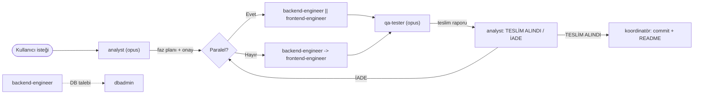

# İş Akışı

> Okur: koordinatör ve tüm ajanlar. Bu dosya sürecin tek kaynağıdır.

## 1. Roller ve geçişler



Alt ajanlar birbirini çağıramaz. "backend dbadmin'e erişir" şu demektir: backend-engineer `Docs/Db/` altına talep yazar ve devir notunda
bunu bildirir; koordinatör dbadmin'i **yalnız o taleple** çağırır, sonucu backend-engineer'a geri taşır.

## 2. Faz 0: Analiz (analyst)

Girdi: kullanıcı isteği. Çıktı:

- `Docs/Analysis/Requirements.md`: amaç, kullanıcı rolleri, ekran envanteri, veri varlıkları, kapsam dışı, açık sorular.
- `Docs/Phases/PhasePlan.md`: fazlar. Şablon dosyanın içindedir.

Analist cevapsız maddeyi varsayımla doldurmaz; açık soruları koordinatöre döner, koordinatör kullanıcıya tek turda sorar.
Faz planı **kullanıcı onayı** ile donar. Sonraki değişiklikler `Docs/Phases/Decisions.md` dosyasına tarihli 1-3 satır olarak eklenir.

Faz planı kuralları:

- İlk UI fazı her zaman **Faz T (Tasarım DNA'sı + kabuk prototipi)**dir; kullanıcı onayı olmadan ekran fazlarına geçilmez.
- Her iş kalemi `FE` / `BE` / `DB` etiketiyle sahibini gösterir.
- Her faz için `Paralel: Evet | Hayır` ve gerekçesi yazılır. `Evet` ise **sözleşme** zorunludur: route listesi, ViewModel alanları, roller,
  dosya sınırı. Sözleşme yoksa paralel çalışılmaz.
- Her fazın kabul kriterleri test edilebilir cümlelerdir ("Editor rolü /users sayfasında 403 alır").

## 3. Faz döngüsü

| Adım | Kim | Çıktı |
|---|---|---|
| 1. Görevlendirme | koordinatör | Faz planındaki ilgili bölüm + son devir notu ajana verilir |
| 2. Geliştirme | backend-engineer, frontend-engineer (gerekirse dbadmin) | Kod + öz denetim + devir notu |
| 3. Test | qa-tester | `Docs/Delivery/Faz-<N>-Teslim.md` (sabit biçim), QA önerisi GEÇTİ / KALDI |
| 4. Teslim alma | analyst | Raporun "Analist kararı" bölümü: TESLİM ALINDI / İADE; TESLİM ALINDI ise `Docs/Local/ProjeOzeti.md` güncellenir |
| 5. Commit | koordinatör | Faz commit'i, ardından README commit'i |

- KRİTİK ya da YÜKSEK bulgu açıkken QA önerisi KALDI'dır; analist TESLİM ALINDI veremez.
- İADE: bulgular sahibine döner, **en çok 2 tur**. Tur 2'de qa-tester yalnız başarısız maddeleri yeniden test eder ve aynı rapora "Tur 2" bölümü ekler.
  İkinci tur da kalırsa koordinatör durur ve kullanıcıya sorar.
- ORTA bulgular aynı fazda kapanır; DÜŞÜK bulgular yazılı gerekçeyle sonraki faza ertelenebilir (raporda "Açık kalemler").

## 4. Commit ve README

1. Analist TESLİM ALINDI yazdıktan sonra koordinatör `git status` ile değişiklikleri görür, faz dışı dosya varsa ayırır.
2. `git add` (kod + `Docs/Delivery/Faz-<N>-Teslim.md` + varsa `Docs/Delivery/Evidence/Faz-<N>/` + `Docs/Db/` kayıtları) ve commit:

   ```
   Faz <N>: <başlık>

   - <yapılan 1>
   - <yapılan 2>
   Teslim raporu: Docs/Delivery/Faz-<N>-Teslim.md
   ```

   Claude etiketi (`Co-Authored-By`, "Generated with") eklenmez.
3. README "Faz Durumu" tablosu güncellenir (durum, tarih, commit kısa hash'i, rapor bağlantısı) ve ayrı commit atılır:
   `docs: README güncellendi (Faz <N>)`. Bu commit için yeniden README güncellemesi yapılmaz.
4. Faz dışı commit'lerde (düzeltme, doküman) de aynı kural: commit, ardından README'de "Son değişiklikler" satırı.

## 5. Devir notu (tek biçim)

Her ajan işini `Docs/Handover/<ajan>-<yyyymmdd-hhmm>.md` dosyasıyla kapatır ve aynı metni son mesajında döner.
Ajan başına yalnız son not kökte durur; eskiler `Docs/Handover/Archive/` altına taşınır.

```
DEVİR: <ajan> -> <sonraki>   Faz: <N>   Dosya: Docs/Handover/<ajan>-<tarih>.md
Yapıldı: <3-6 madde>
Doğrulama: <komut + sonuç>
Sonrakinin bilmesi gerekenler: <route, ViewModel, rol, dosya yolu>
DB talebi: <yok | Docs/Db/DB-<id>.md>
Açık/ertelenen: <madde, sahibi, gerekçe>
```

## 6. Dosya sahipliği

| Yol | Sahibi |
|---|---|
| `Docs/Analysis/`, `Docs/Phases/`, `Docs/Local/` | analyst |
| `Docs/Design/Dna.md`, `Views/**`, `Styles/**`, `wwwroot/**`, `tailwind.config.js`, `package.json` | frontend-engineer |
| `Controllers/**`, `Services/**`, `ViewModels/**`, `Authorization/**`, `Program.cs`, `appsettings*.json` | backend-engineer |
| `Domain/Entities/**`, `Data/**` (DbContext, Configurations, Migrations, Seed), `Docs/Db/` kayıt sonuçları | dbadmin |
| `Docs/Delivery/**`, `.qa/**` | qa-tester (yalnız "Analist kararı" bölümü analistin) |
| `README.md`, commit'ler | koordinatör |

Başkasının dosyasında değişiklik gerekiyorsa ajan değiştirmez; devir notunda sahibine yazar.

## 7. Proje özeti (yerel, repoya girmez)

`Docs/Local/ProjeOzeti.md` projeyi ve alınan kararların gerekçesini anlatan kısa dokümandır; `.gitignore` ile repo dışında tutulur.
Sahibi analisttir. Faz 0 planı onaylanınca açılır, her TESLİM ALINDI kararında güncellenir. İki sayfayı geçmez:

1. Proje ne, kimin için (3-5 cümle)
2. Kapsam ve kapsam dışı
3. Kararlar: her biri "Ne karar verdik / Neden / Neyi bıraktık" (iş birimi kararları ve teknik kararlar ayrı)
4. Süre hesapları: formüller ve örnek
5. Faz durumu: tamamlanan fazlar, tarih, bir satır özet
6. Açık konular

Üslup `CodingStandards.md §8` ile aynı: sade, pazarlama dili ve tekrar yok.
